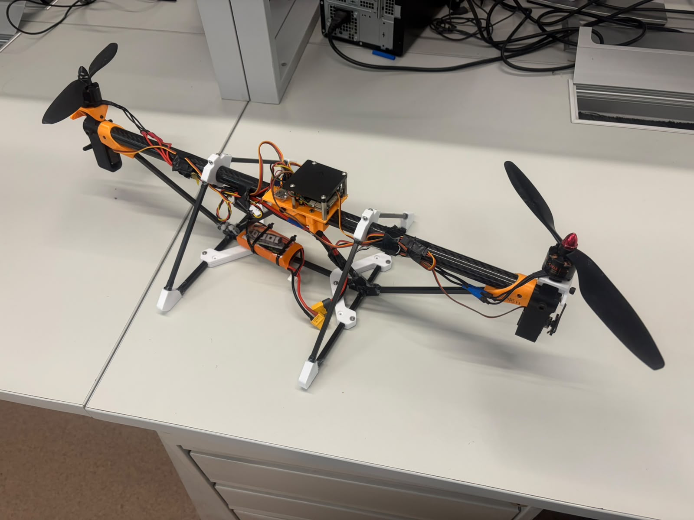
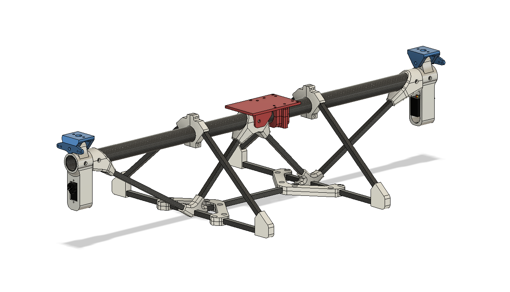
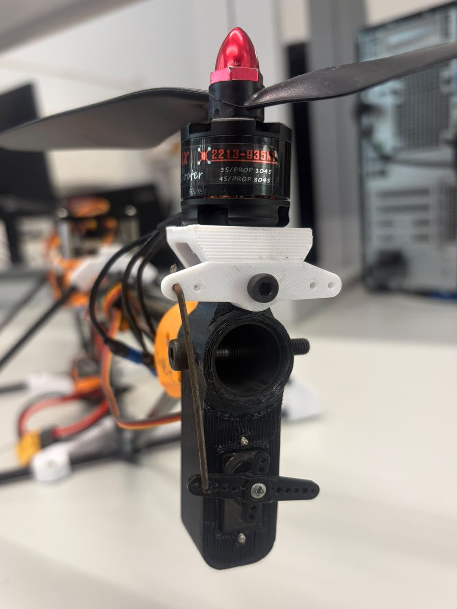
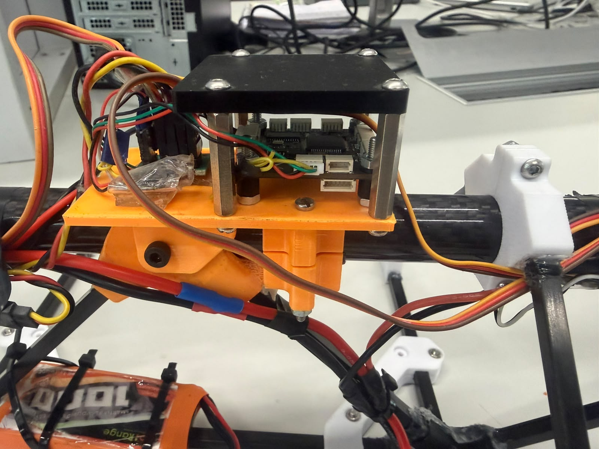

## Project Overview

An ongoing project to design and build a custom bicopter using two BLDC motors and two servos for thrust vectoring. The project explores the mechanical design and flight-control challenges of stabilising and manoeuvring a two-motor aerial platform.

{width=500}

## Mechanical Design

Designed a lightweight frame using **carbon-fibre tubes**, joined together using custom 3D-printed connectors. Motors are controlled by servos using a linkage mechanism. Refinement of frame structure is still ongoing.

{width=700}

{width=500}

## Flight Control

The platform uses a **MicoAir F405 flight controller** running INAV, configured with a bicopter mixer. Initial flight testing has been carried out, with PID tuning and control refinement still ongoing.

{width=500}

## Video Demonstration

::: {#fig-fp_video}

<video src="old_2.mp4" width="600" autoplay loop muted playsinline></video>

One of the first flight tests with minimal tuning.
:::

::: {#fig-fp_video}

<video src="old_1.mp4" width="600" autoplay loop muted playsinline></video>

Servos were noisy and jittery causing oscillations.
:::