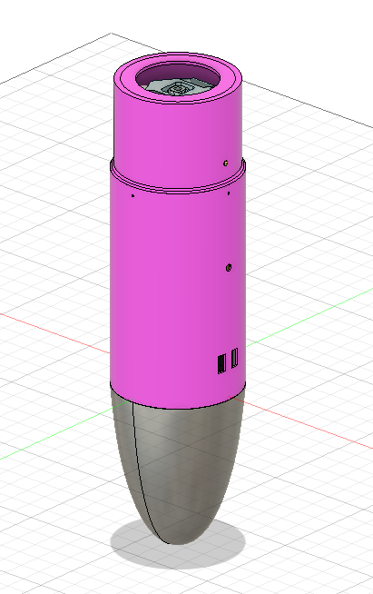
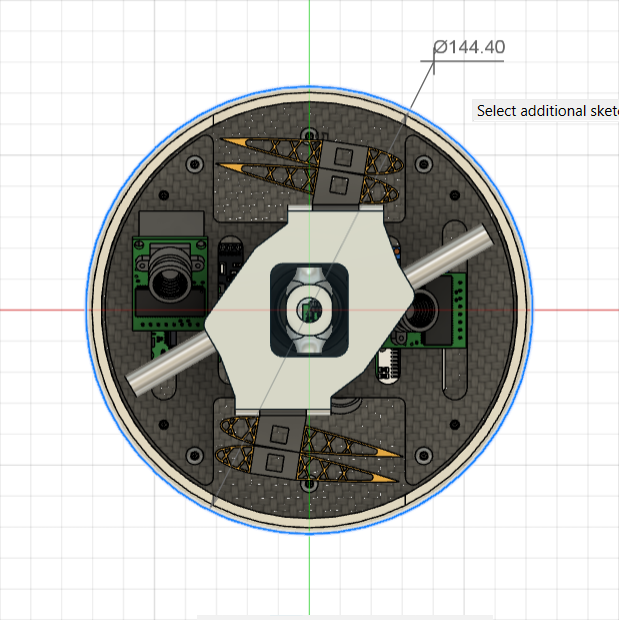
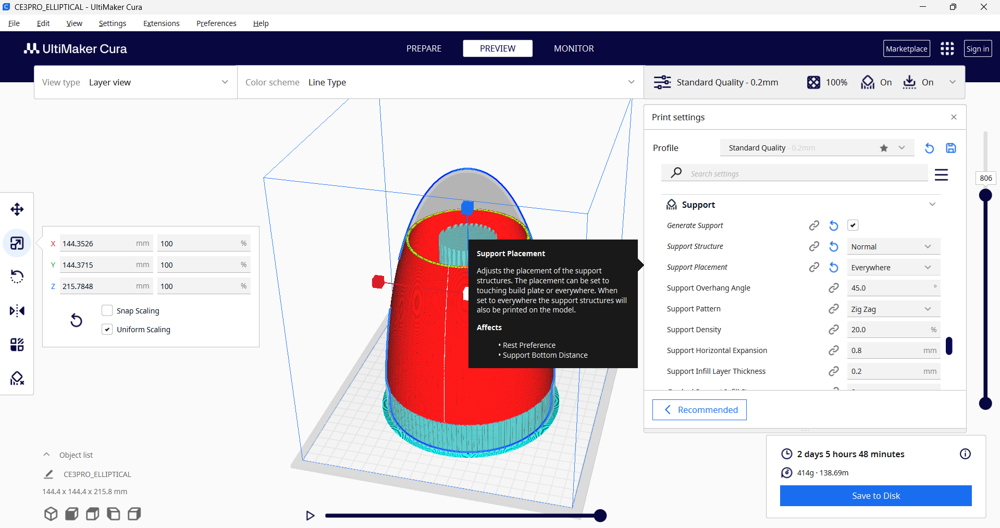
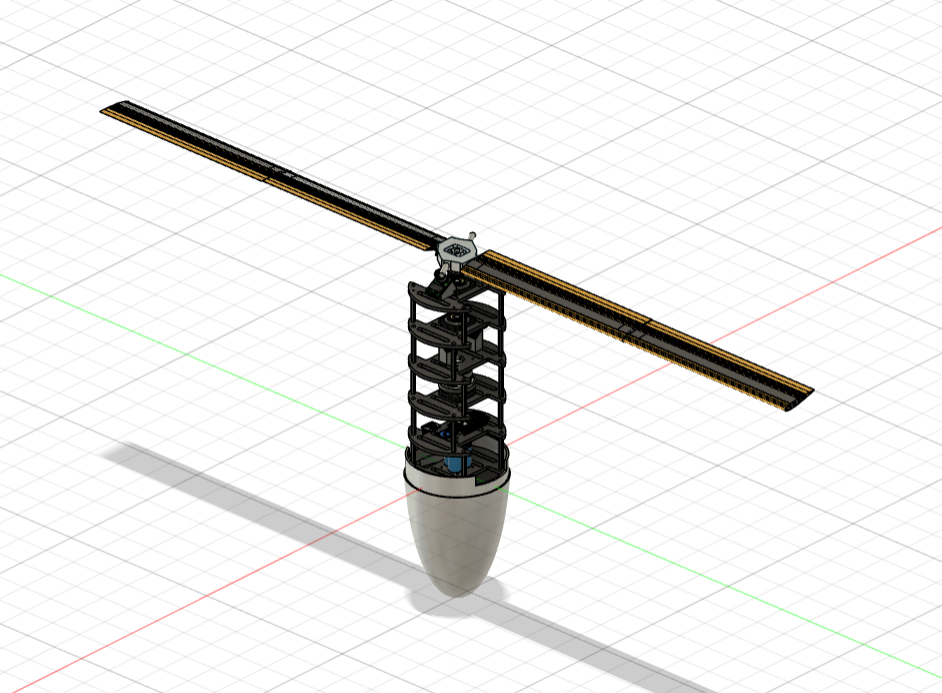
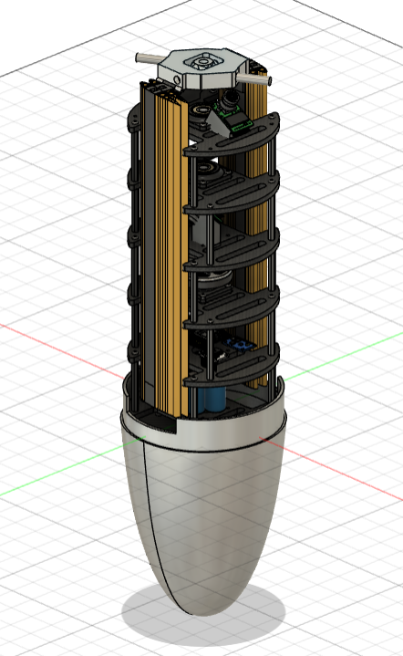
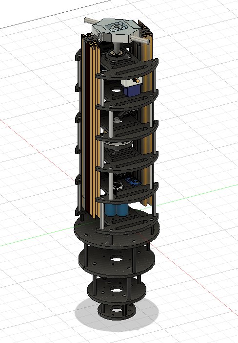
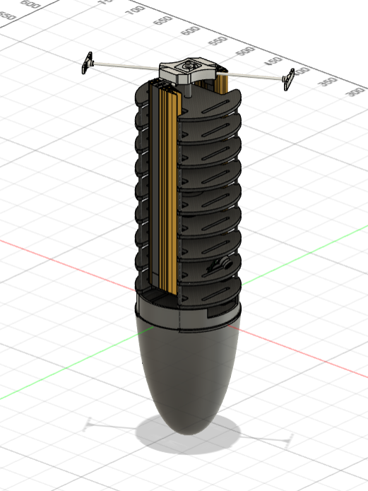
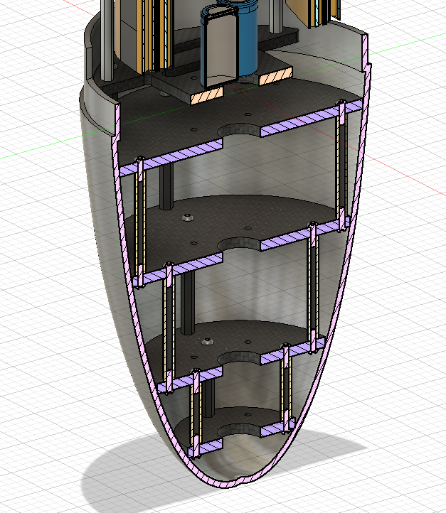
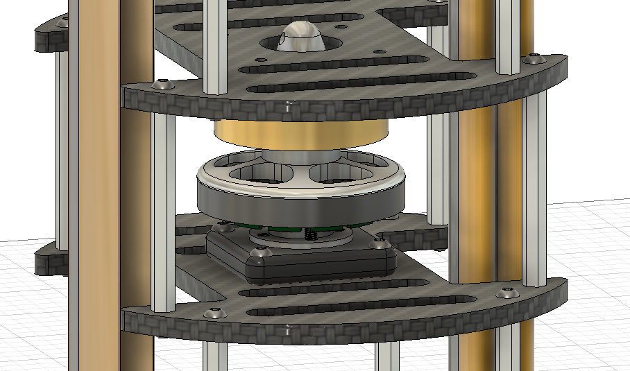
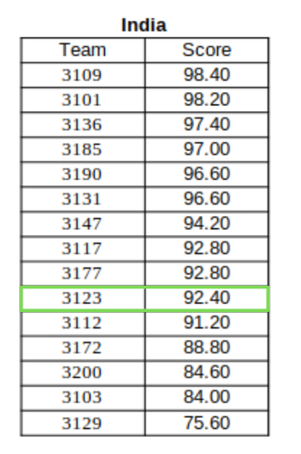

## Instructor: [Prof. Shashank Tamaskar](https://www.linkedin.com/in/shashank-tamaskar-67a2b919/)

## Project Overview

[CanSat 2025](https://cansatcompetition.com/docs/CanSat_Mission_Guide_2025b.pdf) was my first major engineering project in college and Plaksha University's first participation in an international robotics competition. Our team consisted primarily of first- and second-year students.

I served as the **Head of Mechanical Design** of our team - [Team Kalki](https://www.linkedin.com/company/team-kalki/posts/), spending most of my time developing CAD models and mechanical assemblies in Fusion 360. This was my first exposure to multidisciplinary engineering projects, formal design reviews, and designing within strict competition constraints.

## Problem Statement — Auto Gyro Descender

The 2025 AAS [CanSat competition](https://www.cansatcompetition.com/) challenged teams to develop a miniature satellite with a two-stage descent mechanism.

- **Rocket ascent:** The CanSat acts as the rocket's nose cone.
- **Initial descent:** Following ejection, the CanSat descends under a parachute at approximately 20 m/s.
- **Payload separation:** The payload separates from its container at 75% of peak altitude.
- **Autogyro deployment:** The payload deploys an autogyro mechanism to achieve a descent velocity of approximately 5 m/s.
- **Telemetry:** Flight data is transmitted to a ground station throughout the mission.

The primary mechanical challenge was integrating the satellite structure, electronics and deployable autogyro mechanism within the competition's packaging and dimensional constraints.

## My Contributions

As Head of Mechanical Design, I was responsible for the mechanical architecture and CAD development.

- Designed the satellite body and internal structure in **Fusion 360**.
- Designed the autogyro blades and incorporated them into the complete assembly.
- Worked extensively on CAD assemblies, component interfaces, clearances and packaging.
- Collaborated with the electronics team on subsystem integration.
- Contributed to technical documentation and preparation for the Preliminary Design Review (PDR).
- Assisted in getting parts 3D printed and assembled for testing and integration.

{width=700}

{width=700}

{width=700}

## Autogyro Design and Development

One of the most challenging aspects of the mechanical design was accommodating the autogyro descent mechanism within the CanSat's limited packaging volume.

Our calculations indicated that the autogyro required a blade approximately **twice the length of the CanSat itself** to achieve the required descent performance. Accommodating such a large deployable structure within a relatively small satellite presented a significant mechanical design challenge.

{width=700}

{width=700}

{width=700}

I worked on developing the blade geometry and integrating the deployment mechanism into the overall CAD assembly. We went through **2–3 design iterations**, refining the geometry and packaging arrangement to find a workable solution that could fit within the CanSat during ascent and deploy during descent.

{width=700}

This process required considerable assembly-level thinking, particularly around component clearances, available volume, and the interfaces between the deployable mechanism and the satellite structure.

{width=700}

{width=700}

## Competition and Key Outcomes

Our team achieved a **92.4% PDR score**.

This was my first experience with formal engineering documentation and design reviews. I learnt to work within a competition rulebook, justify engineering decisions, communicate ideas effectively and coordinate work across multidisciplinary teams.

The project strengthened my understanding of mechanical system design under packaging constraints and reinforced the importance of assembly-level thinking.

{width=700}

## Mentoring — CanSat 2026

I subsequently mentored Plaksha University's team participating in CanSat 2026, sharing the experience and engineering practices I had developed during my own participation.

The team secured **3rd place in India with a score of 95.4%**.

This was a rewarding opportunity to contribute to the next batch of students and help build upon the experience of the previous team.

## PDR

The PDR we submitted is available below.

```{=html}
<div class="embed-frame embed-frame-doc">
<iframe src="/assets/files/Cansat_2025_3123_pdr.pdf" title="Preliminary Design Review"></iframe>
</div>
```