## Project Overview

Equinox was an independent engineering project through which I designed, developed, and commercialized a custom carbon-fibre frame for FPV freestyle drones. The project combined my experience as an FPV pilot with my interests in mechanical design, structural engineering, and product development.

The idea originated from my dissatisfaction with commercially available FPV frames. Most frames available in the Indian market were imported, expensive, and often prioritized durability, aesthetics, and compatibility over flight performance. Having spent considerable time building, flying, and tuning FPV drones, I had a fairly good understanding of the mechanical limitations that could affect an aircraft's behaviour.

I wanted to develop a frame that addressed these shortcomings: mechanically rigid, lightweight, compatible with commonly available electronics, and competitively priced. The project progressed from initial sketches and CAD models to 3D-printed prototypes, carbon-fibre fabrication, flight testing, and eventually commercial production.

The final design was fabricated using T300 carbon fibre, registered with the Indian Patent Office under Design No. 392685-001, and commercialized in the Indian FPV market, with 15 units sold.

## Why I Designed My Own Frame

My motivation came from three problems I repeatedly encountered with existing FPV frames:

- **Poor mechanical rigidity:** The frame I was previously flying was not sufficiently rigid. Motor vibrations were easily transmitted through the structure to the flight controller's gyroscope. These unwanted high-frequency vibrations were interpreted as actual aircraft movement, contributing to wobbles and oscillations during flight.
- **High cost:** Performance-oriented frames were expensive, both in India and internationally. This made high-quality hardware relatively inaccessible to beginner pilots.
- **Limited compatibility:** Many high-performance frames offered limited mounting options and tight electronics clearances. Installing different combinations of flight controllers, ESCs, receivers, and other electronics could become difficult.

I wanted to approach frame design from the perspective of an actual pilot. Rather than simply developing another durable carbon-fibre frame, my objective was to improve the mechanical characteristics that directly influence flight performance.

## Design Objectives

I established a few primary objectives before beginning the design:

- **Performance:** A mechanically sound structure that was lightweight, rigid, and durable, with a true-X configuration for predictable flight characteristics.
- **Vibration isolation:** Minimize the transmission of motor vibrations to the flight controller and IMU.
- **Compatibility:** Accommodate commonly used electronics and provide sufficient space for different component configurations.
- **Affordability:** Develop a competitively priced alternative to existing performance-oriented frames.
- **Larger wheelbase:** Support propellers up to 5.5 inches, allowing the aircraft to carry heavier action cameras.
- **Freestyle-oriented layout:** Incorporate a true-X configuration and the inverted battery mounting arrangement commonly referred to as the "toilet tank" style.

These objectives guided the mechanical design and the decisions made throughout the development process.

## Mechanical Design and CAD

I developed the frame using FreeCAD, beginning with rough sketches on graph paper before translating the geometry into a parametric CAD model. I studied several existing freestyle frames, particularly high-performing designs, to understand their geometry, mounting arrangements, and structural layouts.

One of the important considerations was ensuring compatibility with commonly available FPV electronics. I modelled the overall layout around the mounting standards and dimensions of popular components, while leaving sufficient room for wiring, connectors, and accessories.

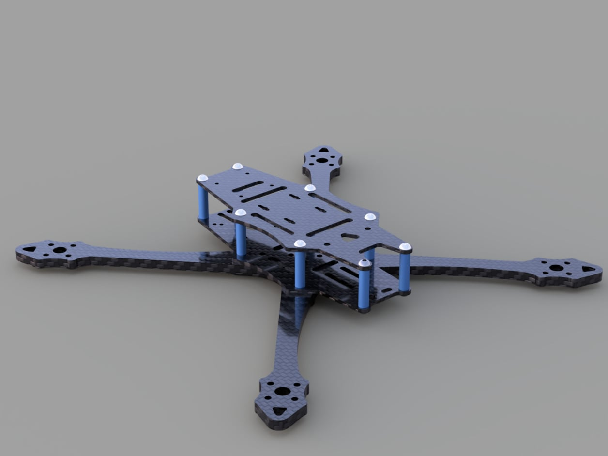{width=700}

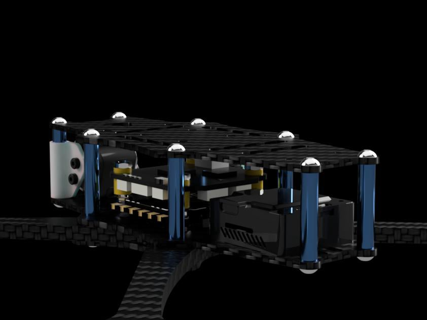{width=700}

Once the CAD model was complete, I 3D-printed a prototype to check its dimensions and physically test the fitment of electronics. This allowed me to identify potential interference issues and make changes before committing to carbon-fibre fabrication.

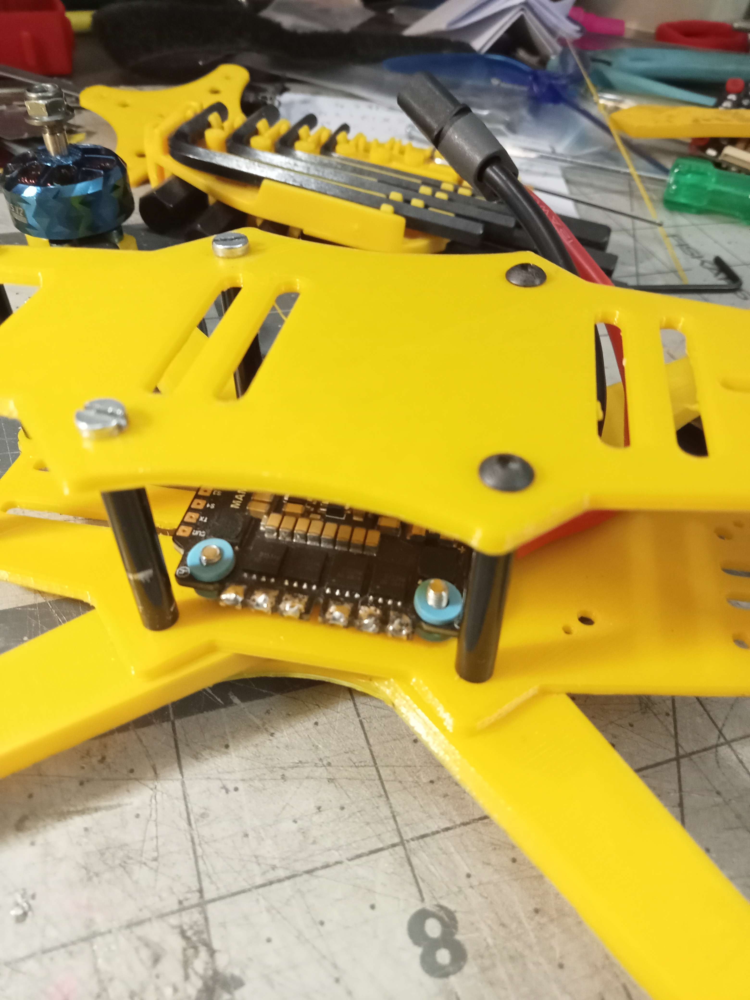{width=700}

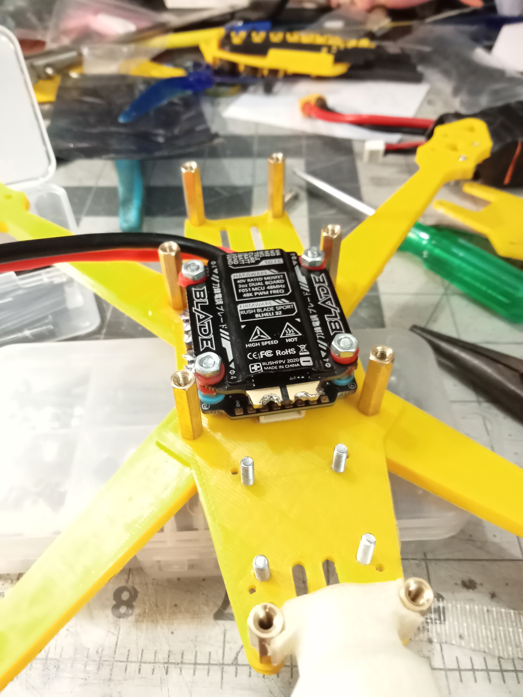{width=700}

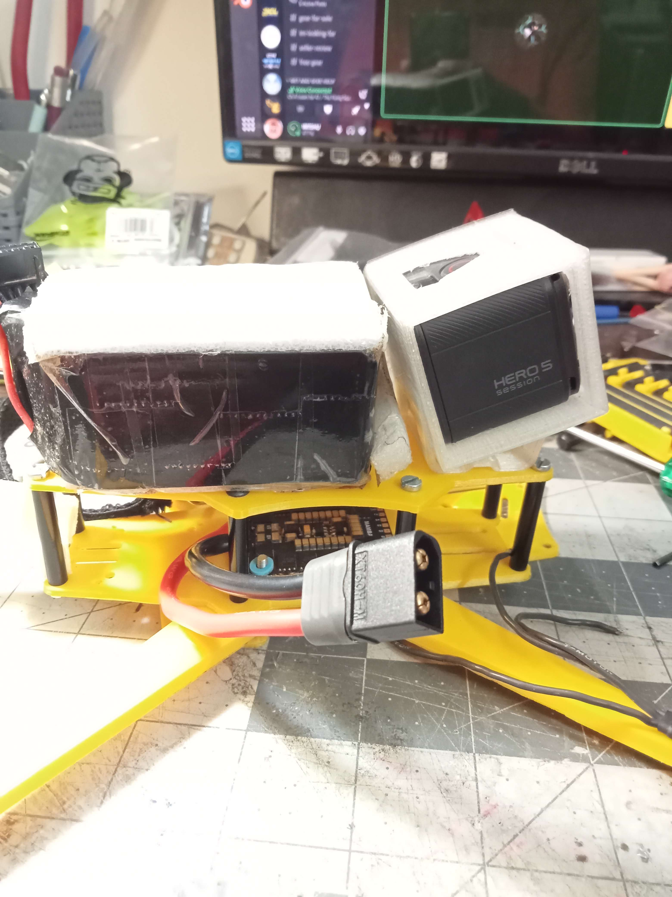{width=700}

## Structural Design Considerations

A major part of the design involved addressing the relationship between frame rigidity, vibration transmission, and flight-controller performance.

One of the key changes was separating the flight-controller mounting hardware from the hardware securing the arms. In many conventional layouts, the same screws are used to secure both the arms and the flight-controller stack. This creates a direct mechanical path through which motor vibrations can propagate towards the gyroscope.

In my design, the stack mounting screws were recessed and mechanically separated from the arm mounting arrangement. This was intended to reduce vibration transmission to the flight controller while also making arm replacement easier.

I also considered how the structure would protect its electronics and respond to crashes. The central electronics compartment was enclosed within the frame structure and surrounded by standoffs, providing additional protection against physical impacts. The geometry was designed so that the arms would make initial contact during many crash scenarios, keeping the central body and electronics relatively protected. Arms were designed to be easily replaceable in field.

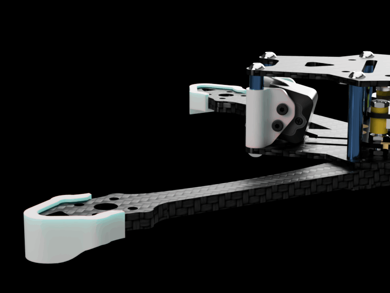{width=700}

These decisions were intended to balance flight performance, serviceability, and durability without unnecessarily increasing the overall weight.

## Material Selection and Fabrication

The frame was designed for fabrication using T300 carbon fibre, selected for its stiffness-to-weight characteristics and suitability for lightweight structural applications.

Getting from CAD to a manufacturable product was one of the more challenging parts of the project. Finding a reliable CNC vendor who could consistently manufacture parts to the required dimensions proved difficult. I also struggled to source suitable M3 press-nuts locally, while high-quality carbon-fibre sheets were relatively expensive.

I initially experimented with a generic carbon-fibre batch, but the material did not match the specifications I had designed around. Subsequent iterations helped identify manufacturing and dimensional issues, particularly the importance of maintaining accurate and identical arm geometries.

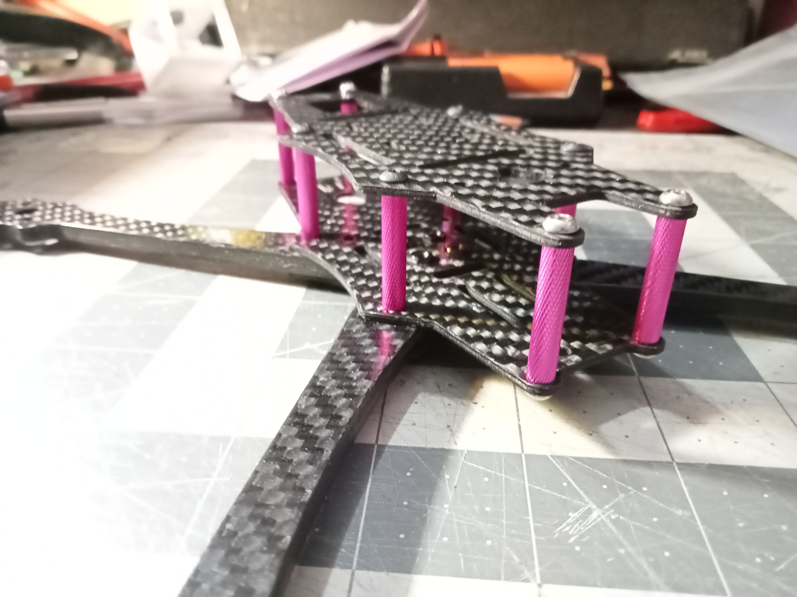{width=700}

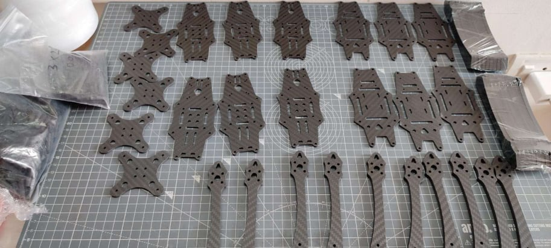{width=700}

Eventually, I coordinated the production of the final batch in China through a manufacturing contact. The final carbon-fibre quality and dimensions were much closer to the intended specifications.

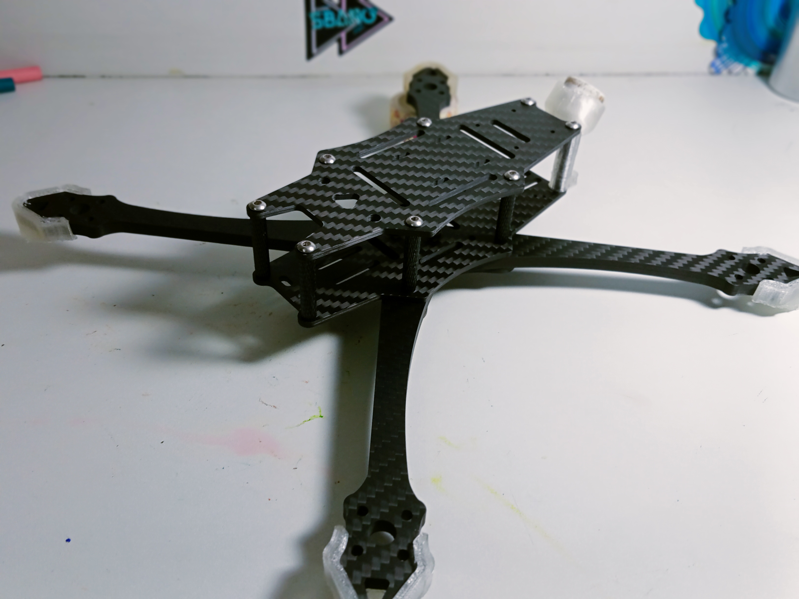{width=700}

## Flight Testing and Blackbox Analysis

Mechanical design alone was not sufficient to evaluate the performance of the frame. Since the ultimate objective was to improve flight characteristics, I used FPV flight testing and Blackbox data to investigate the relationship between mechanical vibrations and flight-controller behaviour.

Blackbox logging records internal flight-controller data, allowing parameters such as gyro measurements, PID responses, motor behaviour, and noise characteristics to be analysed after a flight.

I explored different filtering techniques available in Betaflight, including:

- Static notch filters
- Dynamic notch filters
- RPM filters
- Gyro low-pass filters

An important consideration during this analysis was the trade-off between noise suppression and signal latency. Filtering helps remove unwanted noise from gyro measurements, but excessive filtering can introduce additional delay into the control signal. This can negatively affect how quickly the flight controller responds to actual aircraft movement.

My approach was to understand the frequency distribution of the noise and identify regions where filtering was necessary, rather than applying filters indiscriminately. Filters operating in relatively quiet frequency regions could potentially be reduced or disabled to minimize unnecessary latency.

### Understanding the Blackbox Graphs

The following graphs are from a poorly constructed drone analysed using stock Betaflight filtering settings. They illustrate how different sources of noise appear in flight-controller data and how they can be distinguished.

The noise spectrum for the roll, pitch, and yaw axes provides a comparison between the raw input signal and the filtered output. This helps visualize how effectively the default filter configuration suppresses unwanted noise.

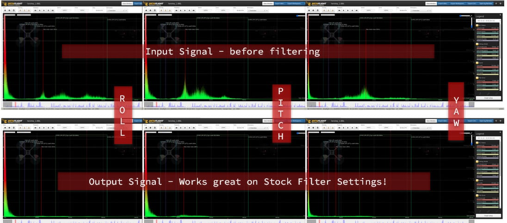{width=700}

Throttle-versus-frequency spectrograms provide another useful perspective. Motor-generated noise appears as frequency bands that change with throttle, while structural resonance appears as relatively fixed-frequency peaks.

In the analysed build, I could identify a structural resonance region that was suitable for treatment using a dynamic notch filter. Motor-related noise, on the other hand, could be addressed using RPM filtering.

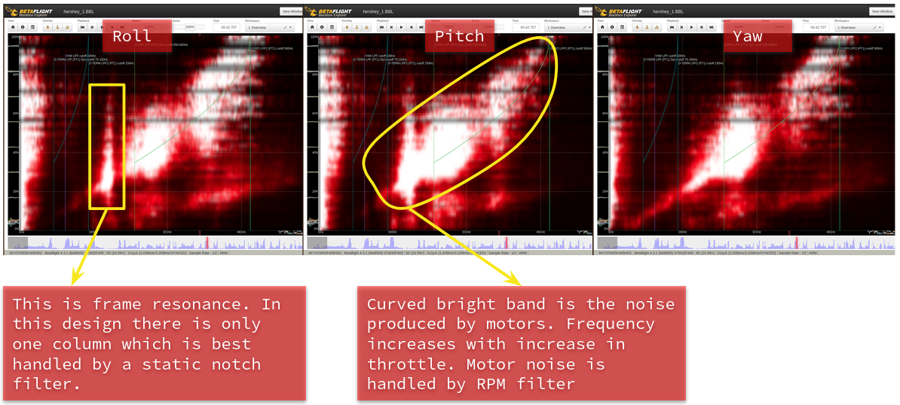{width=700}

I also investigated the effect of disabling filters in frequency regions with relatively little noise. The objective was to avoid unnecessary filtering and reduce signal delay while retaining adequate noise suppression.

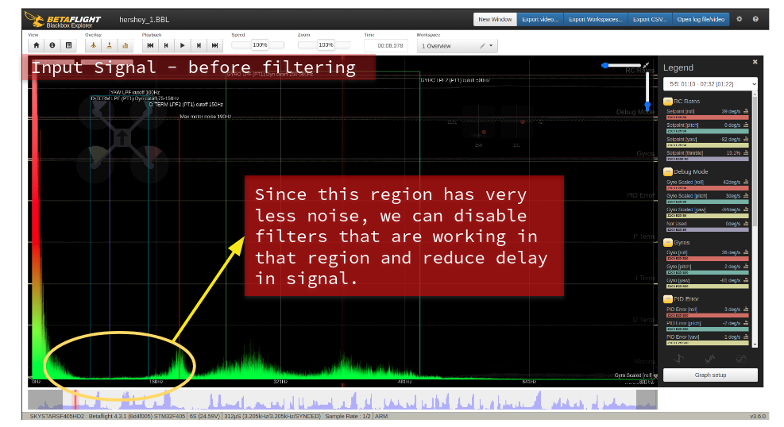{width=700}

Finally, I examined the stock PID response to understand how closely the commanded response tracked the desired setpoint. This provided a baseline for understanding controller behaviour and identifying areas where tuning could be improved.

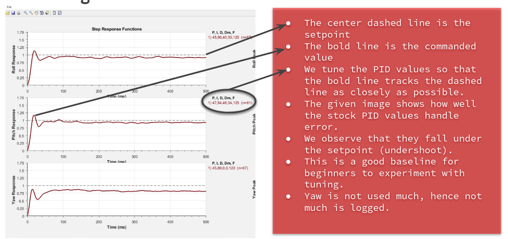{width=700}

These experiments helped me understand that flight performance is influenced by more than PID gains alone. Mechanical rigidity, motor characteristics, structural resonance, sensor noise, and filtering all contribute to the behaviour of a multirotor aircraft.

*Note: The graphs shown are from a separate, poorly constructed test drone and were recorded using default Betaflight settings. Their characteristics are specific to that build and should not be interpreted as measurements of Equinox itself.*

## Challenges and Iterations

The project involved several practical challenges that were not immediately apparent during the CAD design stage.

Finding a reliable CNC manufacturing vendor was particularly difficult. Dimensional inaccuracies in early batches affected the assembly and highlighted how important manufacturing tolerances are for structural interfaces. Sourcing suitable hardware, especially M3 press-nuts, and obtaining high-quality carbon-fibre sheets at a reasonable cost were additional obstacles.

I also attempted finite element analysis using FreeCAD, but interpreting the simulation results proved challenging at the time. Instead, much of my structural evaluation relied on engineering intuition, geometric reasoning, and practical testing.

The development process involved multiple iterations of the frame, with manufacturing feedback and physical assembly helping identify issues that were difficult to anticipate in the initial CAD model.

## Product Development and Commercialization

Equinox eventually progressed beyond a personal engineering project into a commercial product.

I coordinated the manufacturing of the final carbon-fibre frames in China and introduced the product to the Indian FPV market. The final frame had an approximate carbon-fibre weight of 100 g and an assembled hardware weight of 115 g.

The design was registered with the Indian Patent Office under Design No. 392685-001.

A total of 15 units were sold, with additional units used for testing and personal builds. Taking the project from an initial concept to a manufactured and commercialized product gave me experience with the entire product-development process, including CAD, prototyping, material selection, manufacturing coordination, quality control, and sales.

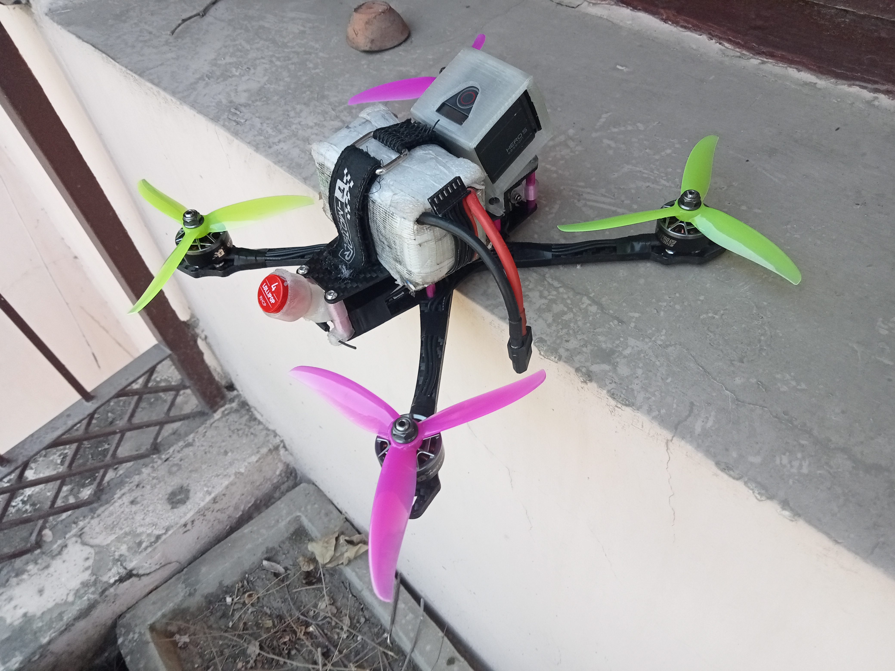{width=700}

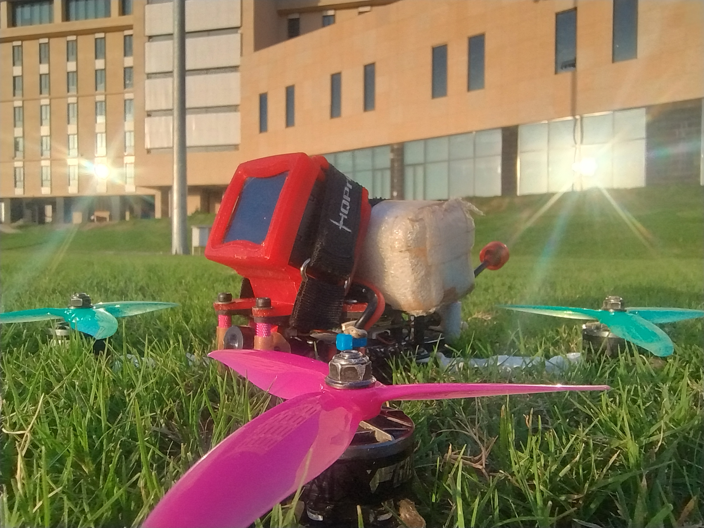{width=700}

## Patent and Intellectual Property

The Equinox frame design was granted a design patent by the Indian Patent Office under **Design Registration No. 392685-001**.

Securing the patent was an important milestone in the project, formally recognizing the frame's original industrial design. It also marked a significant step in taking Equinox beyond an independently developed prototype and establishing it as a commercial product.

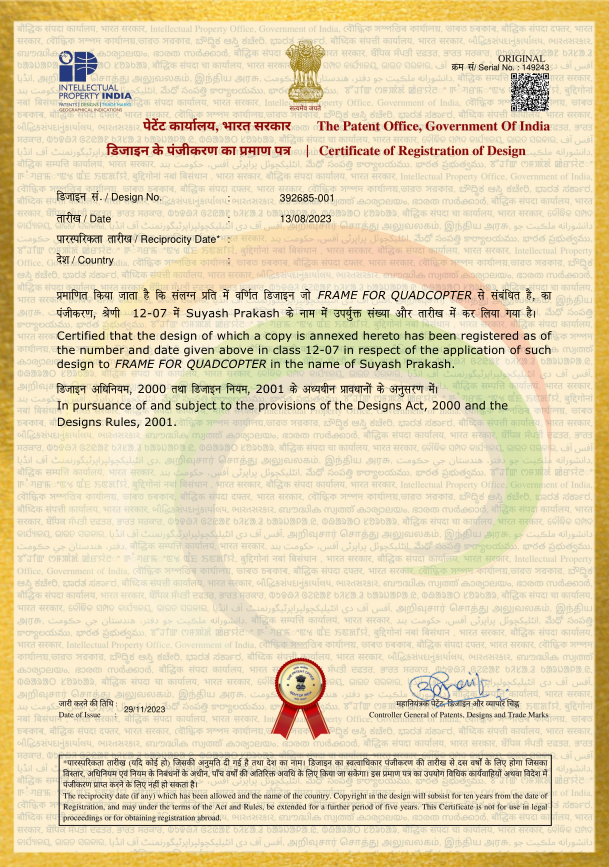{width=650}

## What I Learned

Equinox was one of my first experiences taking an engineering idea through the entire process of design, fabrication, testing, and commercialization.

It taught me that a successful mechanical design is not simply one that looks good in CAD. It must account for material properties, manufacturing limitations, dimensional tolerances, assembly, maintenance, and the actual operating environment.

More importantly, my experience as an FPV pilot allowed me to approach the problem from a practical perspective. I could connect mechanical design decisions to observable flight behaviour and use flight-controller data to investigate problems that would otherwise be difficult to diagnose.

The project strengthened my interest in mechanical design, structural engineering, and the interaction between physical systems and control systems. It also gave me the confidence to take an independently developed hardware product from an idea to a commercially available product.

## Gallery

```{=html}
<div class="project-gallery-wrapper">
  <div class="project-gallery" id="equinox-gallery"></div>
</div>
<div class="gallery-dots" id="equinox-gallery-dots"></div>

<script>
(function () {
  const images = [
    "1000000784.jpg",
    "1000000979.jpg",
    "1000027210.jpg",
    "1000085392.jpg",
    "Flux80stylishphoto.jpg",
    "IMG20221108201739.jpg",
    "IMG20221108203548.jpg",
    "IMG20221108215857.jpg",
    "IMG20230217182359.jpg",
    "IMG20230227185833.jpg",
    "IMG20230227190925.jpg",
    "IMG20230227190943.jpg",
    "IMG20230227192837.jpg",
    "IMG20230228193100.jpg",
    "IMG20230527140436.jpg",
    "IMG20230606195642.jpg",
    "IMG20240103232711.jpg",
    "IMG20240202202422.jpg",
    "IMG20240202202817.jpg",
    "IMG20240202203024.jpg",
    "IMG20240202203247.jpg",
    "IMG20240202203420.jpg",
    "IMG20240202203748.jpg",
    "IMG20240202210255.jpg",
    "IMG20240204151809.jpg",
    "IMG20240213200451.jpg",
    "IMG20240213200501.jpg",
    "IMG20240213200509.jpg",
    "IMG20240213200513.jpg",
    "IMG20240213211056.jpg",
    "IMG20240213212108.jpg",
    "IMG20240213213102.jpg",
    "IMG20240213213646.jpg",
    "IMG20240213220253.jpg",
    "IMG20240330184643.jpg",
    "IMG20240330212159.jpg",
    "IMG_20230721_195638092_HDR.jpg",
    "IMG_20240718_182330086.jpg",
    "IMG_20240718_212300079.jpg",
    "IMG_20240720_010742826.jpg",
    "IMG_20240720_010817164.jpg",
    "IMG_20240720_144857890.jpg",
    "IMG_20240822_181353968_HDR.jpg",
    "Screenshot_from_2022-11-09_18-05-07-1.png",
    "Screenshot_from_2022-11-09_18-05-07.png",
    "Screenshot_from_2022-11-11_14-15-23.png",
    "Screenshot_from_2022-11-15_17-55-03.png",
    "WhatsApp Image 2026-11-12 at 7.09.49 PM (1).jpeg",
    "WhatsApp Image 2026-11-12 at 7.09.49 PM (2).jpeg",
    "WhatsApp Image 2026-11-12 at 7.09.49 PM (3).jpeg",
    "WhatsApp Image 2026-11-12 at 7.09.49 PM (4).jpeg",
    "WhatsApp Image 2026-11-12 at 7.09.49 PM (5).jpeg",
    "WhatsApp Image 2026-11-12 at 7.09.49 PM (6).jpeg",
    "WhatsApp Image 2026-11-12 at 7.09.49 PM.jpeg",
    "img-20230707-wa0000-913x411.jpg",
    "img-20230902-wa00121-913x1217.jpeg",
    "img20240213212108-913x685.jpeg",
    "verstality-pic-842x632.jpg",
    "whatsapp-image-2024-07-12-at-7.58.05-pm-1256x942.jpg"
  ];


  const PER_PAGE = 4; // 2x2
  const gallery  = document.getElementById('equinox-gallery');
  const dotsEl   = document.getElementById('equinox-gallery-dots');

  // Chunk images into pages of 4
  const pages = [];
  for (let i = 0; i < images.length; i += PER_PAGE) {
    pages.push(images.slice(i, i + PER_PAGE));
  }

  // Build pages
  pages.forEach((pageImgs, pi) => {
    const page = document.createElement('div');
    page.className = 'gallery-page';

    pageImgs.forEach(filename => {
      const img = document.createElement('img');
      img.src     = `gallery_imgs/${filename}`;
      img.alt     = filename;
      img.loading = 'lazy';
      img.title   = 'Click to open full resolution';
      img.onclick = () => window.open(img.src, '_blank');
      page.appendChild(img);
    });

    // If last page has < 4 images, fill blanks so grid stays even
    for (let j = pageImgs.length; j < PER_PAGE; j++) {
      const blank = document.createElement('div');
      blank.className = 'gallery-placeholder';
      page.appendChild(blank);
    }

    gallery.appendChild(page);
  });

  // Dot indicators
  const dots = pages.map((_, i) => {
    const d = document.createElement('button');
    d.className = 'dot' + (i === 0 ? ' active' : '');
    d.setAttribute('aria-label', `Go to page ${i + 1}`);
    d.onclick = () => gallery.scrollTo({ left: i * gallery.clientWidth, behavior: 'smooth' });
    dotsEl.appendChild(d);
    return d;
  });

  // Update active dot on scroll
  gallery.addEventListener('scroll', () => {
    const idx = Math.round(gallery.scrollLeft / gallery.clientWidth);
    dots.forEach((d, i) => d.classList.toggle('active', i === idx));
  });

  // Mouse-wheel → horizontal slide (one full page per scroll tick)
  gallery.addEventListener('wheel', e => {
    if (e.deltaY === 0 || e.shiftKey) return;
    const atStart = gallery.scrollLeft <= 0 && e.deltaY < 0;
    const atEnd   = gallery.scrollLeft + gallery.clientWidth >= gallery.scrollWidth - 1 && e.deltaY > 0;
    if (!atStart && !atEnd) {
      e.preventDefault();
      const currentPage = Math.round(gallery.scrollLeft / gallery.clientWidth);
      const targetPage  = currentPage + (e.deltaY > 0 ? 1 : -1);
      gallery.scrollTo({ left: targetPage * gallery.clientWidth, behavior: 'smooth' });
    }
  }, { passive: false });
})();
</script>