## Project Objective

This project develops a test platform to experimentally characterize the custom DC motors and gearboxes used in the RangerMax biped. The platform measures torque, speed, current, voltage and gearbox behavior under dynamic and controlled conditions. The collected data will be used for system identification and development of data-driven motor models for improved controller design, reducing reliance on vendor specifications.

## Why Characterization

Motor datasheets do not describe transient response, thermal effects, gearbox backlash or parameter variation during operation. Measuring these quantities provides data required for accurate control-oriented models. The end goal is to make a look-up table for the controller.

Deadband analysis is another important objective. Specifically, we want to characterize three types of deadband:

- **Brush voltage deadband:** Minimum voltage required to initiate motor rotation.

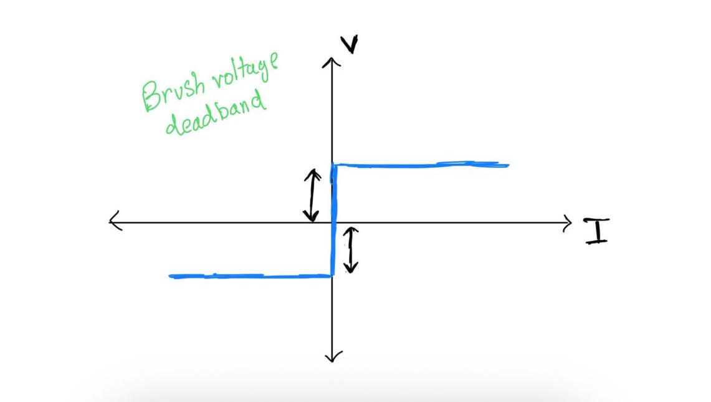{width=700}

- **Gearbox backlash deadband:** Lost motion during direction reversal due to mechanical play in the gearbox.

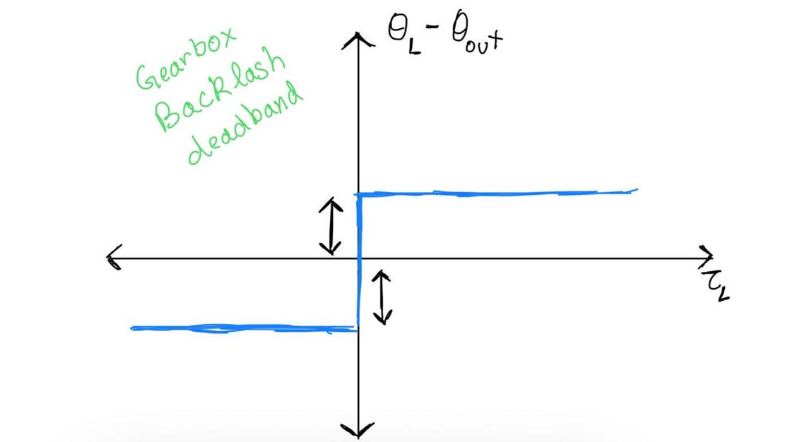{width=700}

- **Frictional deadband:** Input required to overcome friction before consistent movement begins.

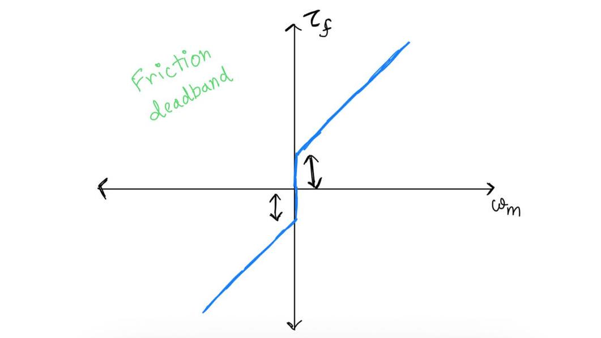{width=700}

## Test Rig Design

- Designed a modular motor test rig with interchangeable motor mounts and load attachments.
- Got rid of the previous issues of the first frame, in which the motor was mounted in a different plane to the foil tensioners.
- Made a rigid joint for the load-cell to get rid of play unlike last time.
- Investigated frame reinforcement using diagonal bracing.

We plan on using aluminium extrusions for the frame. Everything is built around it. Acrylic sheets are used to make everything else. Standoffs and screws are primarily used.

## Measurements

A complete characterization platform allows repeatable measurement of:

- **Torque** → Done using load-cells.
- **Shaft speed** → Motor encoder before and after gearbox.
- **Motor current** → Current sensor which is calibrated.
- **Supply voltage** → Constant given by a bench power supply.
- **Back EMF** → Voltage sensor before motor (actual motor voltage).
- **Dynamic response** → Different types of input signals (step, ramp, sine).
- **Gearbox backlash** → Difference between both encoders.

These measurements can later be used for system identification and feedforward model development.

## Electronics and Data Acquisition

- **Teensy 4.1** serves as the central data acquisition unit.
- **Load Cell + HX711 Amplifier** measures output torque.
  - The load cell connects to the HX711 amplifier.
  - HX711 communicates with Teensy using digital GPIO pins (Clock and Data).
  - Better amplifier are to be tested.
- **Incremental Rotary Encoder** measures shaft position and speed.
  - Encoder A and B channels connect to Teensy interrupt-capable digital pins.
  - Hall encoder with diametric magnet will be used before gearbox.
  - Optical high PPR encoder on output shaft.
- **Current Sensor with shunt resistor** measures motor current.
  - Analog voltage output connects to a Teensy ADC module.
- **Voltage Sensor / Voltage Divider** measures motor supply voltage from driver.
  - Analog output connects to another Teensy ADC module.
- **Motor Driver / Power Supply** powers the test motor independently of the Teensy.
  - The Teensy only measures signals and does not supply motor power.
- **USB Connection** links the Teensy to the laptop.
  - Used for power, programming, and high-speed serial communication.
  - Teensy reads sensor values and does basic computation to give RPM, torque, current, voltage, PWM, etc.
- **Python Data Acquisition Script** runs on the laptop.
  - Python script reads serial data from Teensy.
  - Timestamps and logs synchronized sensor measurements.
  - Saves the data to CSV files for post-processing.
  - Display live plots of quantities such as torque, speed, current, and temperature during experiments.

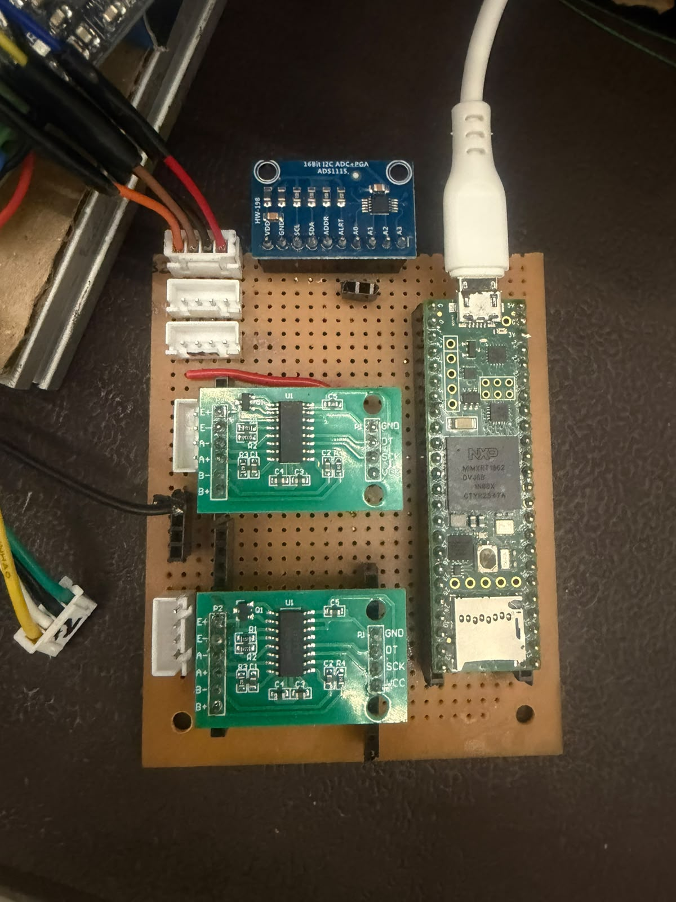{width=700}

## Experimental Plan

- Conduct experiments under controlled supply voltage and known mechanical loading conditions.
- Excite the motor using multiple input signals to capture both steady-state and transient behavior.
- Planned excitation signals include:
  - Step PWM inputs.
  - Ramp PWM inputs.
  - Sinusoidal PWM inputs of varying frequencies.
- Perform experiments under different load inertias using interchangeable flywheels.
- Record synchronized measurements of:
  - Applied PWM command.
  - Previous PWM commands (input history).
  - Motor voltage.
  - Motor current.
  - Output torque.
  - Shaft position.
  - Shaft speed.
  - Time stamp.

- Store the current and previous PWM values with every sample, as motor response depends on past inputs due to electrical and mechanical dynamics. This input history is particularly useful for data-driven system identification and neural-network-based model development.
- Save all synchronized measurements in CSV format for subsequent system identification, model validation and controller development.

## Feedforward Model Development

The primary objective of the characterization platform is to develop a feedforward model that predicts the actuator input required to produce a desired motion. Unlike a feedback controller, which reacts to errors after they occur, a feedforward controller estimates the required motor command directly from the desired operating conditions.

The experimental platform developed in this project measures the quantities required to identify these behaviors directly from experimental data. During testing, synchronized measurements of motor voltage, PWM command, current, torque, shaft position, speed, acceleration and temperature are recorded under different operating conditions. The resulting dataset captures both steady-state and transient responses of the actuator.

A combined feedforward and feedback control block system merges predictive disturbance compensation (from the model) with reactive error correction (feedback part).

## Data-Driven Feedforward Models

The same dataset can also be used to learn the inverse dynamics of the actuator.

Instead of predicting motor behavior from an input voltage, the model learns the opposite relationship:

**Possible model inputs include:**

- Desired position.
- Desired velocity.
- Desired acceleration.
- Applied load torque.
- Motor temperature.
- Previous PWM commands.
- Previous measured states.

**Model outputs may include:**

- PWM duty cycle.
- Required motor voltage (simple PWM ratio-ing to give PWM output).
- Required motor current (and then we have current control).

Including previous PWM commands and previous measured states allows the model to account for actuator memory arising from electrical inductance, rotor inertia and gearbox dynamics. This is important because the current motor output depends not only on the present command but also on recent operating history.

For example, 100 RPM while accelerating versus 100 RPM while decelerating would require different PWM to reach a target of 200 RPM within the same time-frame.

The final outcome of this work is a control-oriented feedforward model capable of predicting actuator commands directly from desired motion. Such a model can compensate for nonlinear actuator behavior before tracking errors occur, improving motion accuracy and reducing the effort required from the feedback controller.

## Design Version 1 — Initial Test Rig

The first version focused on developing the torque measurement mechanism using load cells.

The setup consisted of a central rotating section supported by a frame, with four tensioned aluminium strips. A torque transfering beam was attached to the central section. A pretensioning arrangement was introduced to establish an initial loading condition before conducting measurements.

The structure was assembled using laser-cut acrylic components, mounting blocks, fasteners and custom supports. 

It served as a proof-of-concept for the tensioning mechanism.

**Key design elements:**

- Four tensioned aluminium aluminium strips keep the central section restricted.
- Cantilever-based load-cell design.
- Pretensioning mechanism to establish the initial load.

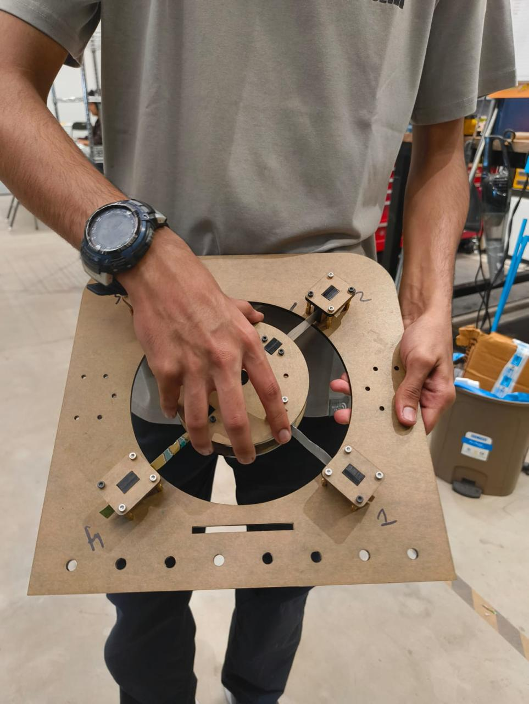{width=700}

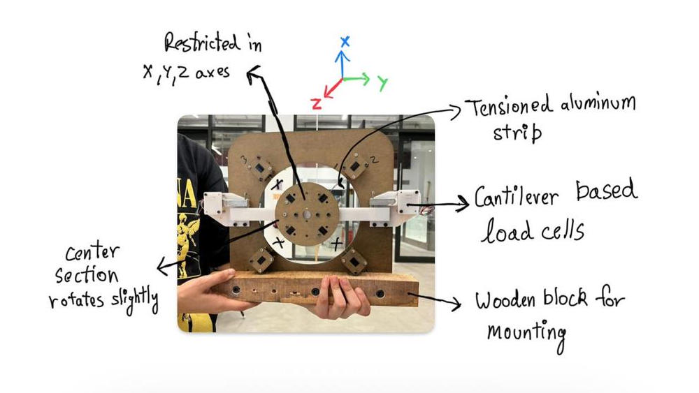{width=700}

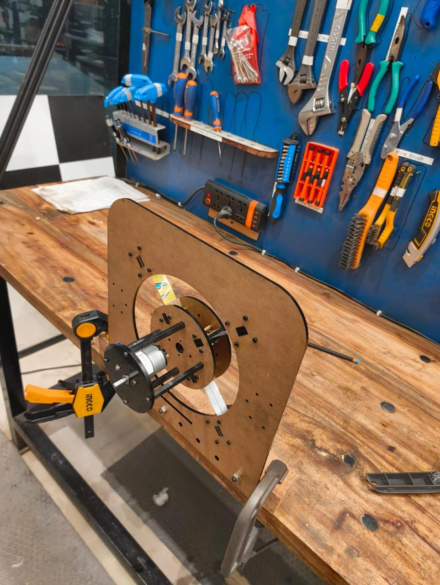{width=700}

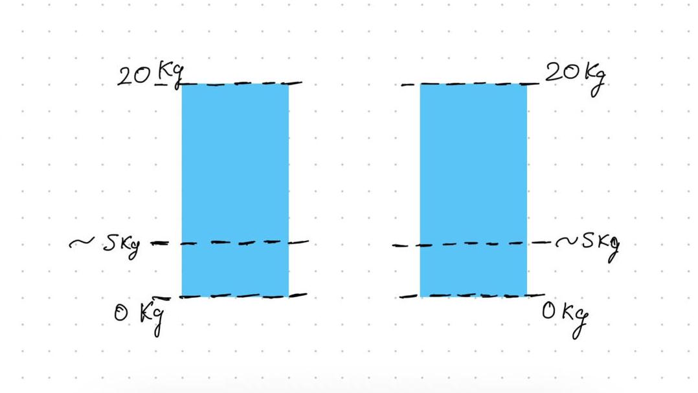{width=700}

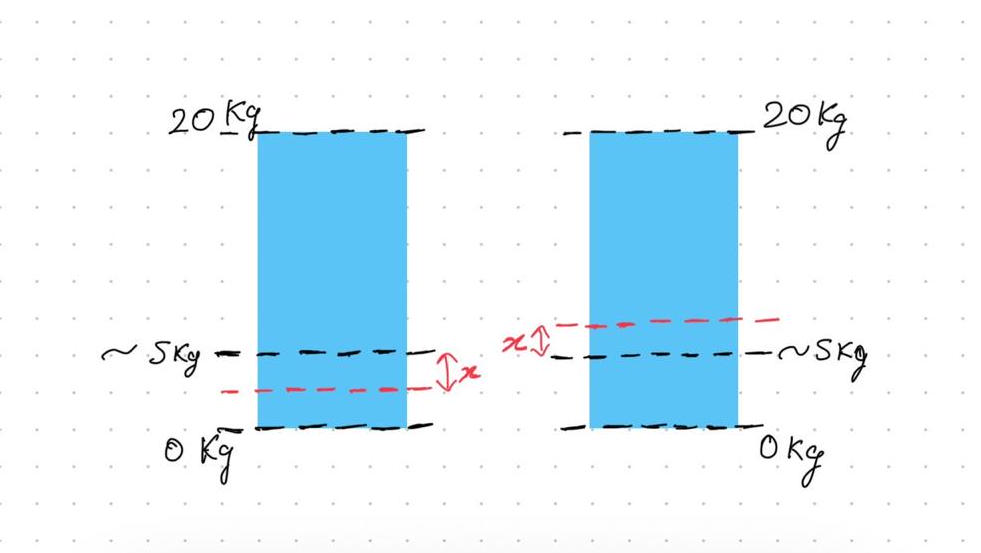{width=700}

## Design Version 2 — Revised Test Rig

The second version addresses the mechanical limitations identified in the first design.

The motor and foil tensioners are now arranged in the same plane to ensure proper alignment of the loading mechanism. The load-cell connection has also been redesigned as a rigid joint to eliminate unwanted mechanical play.

The revised platform is designed around aluminium extrusions, with acrylic sheets, standoffs and screws used for mounting the remaining components.

**Key improvements:**

- Improved alignment between the motor and foil tensioners.
- Rigid load-cell connection to eliminate mechanical play.
- Modular motor mounts and interchangeable load attachments.
- Aluminium extrusion-based frame.
- Investigation of diagonal bracing for improved structural rigidity.

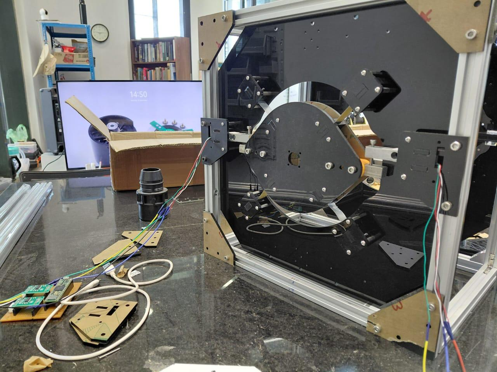{width=700}

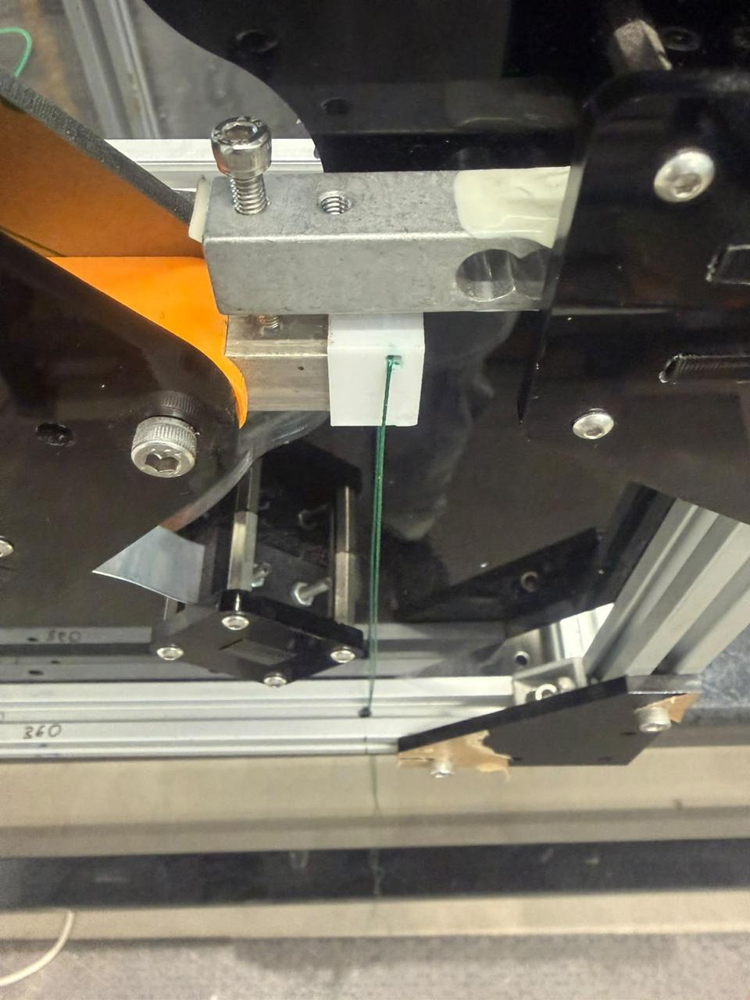{width=700}

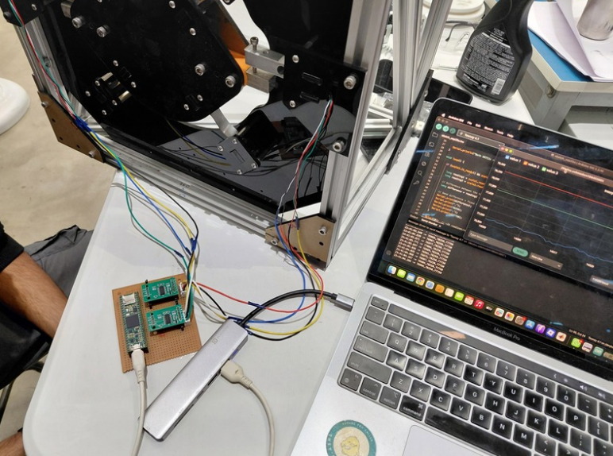{width=700}

## Ongoing Work

The electronics and data acquisition architecture are largely sorted. The remaining hardware integration includes installing the motor encoder and completing load-cell calibration.

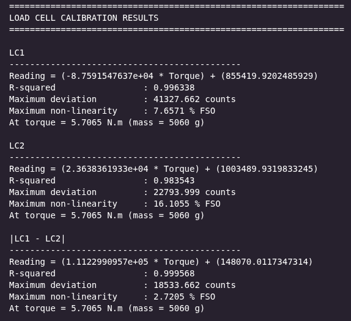{width=700}

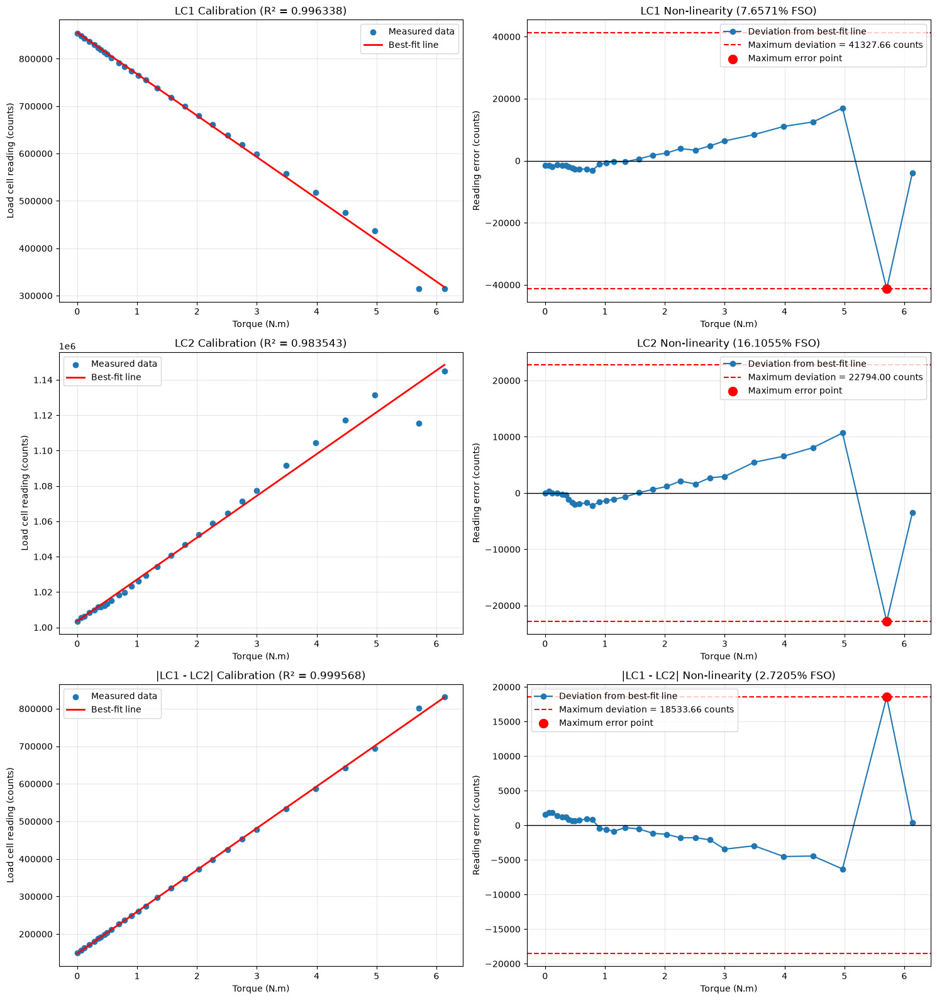{width=700}

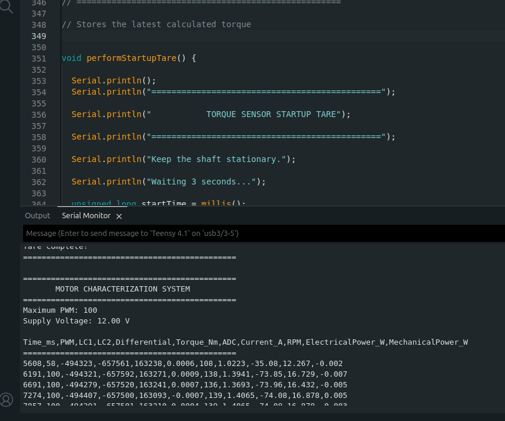{width=700}

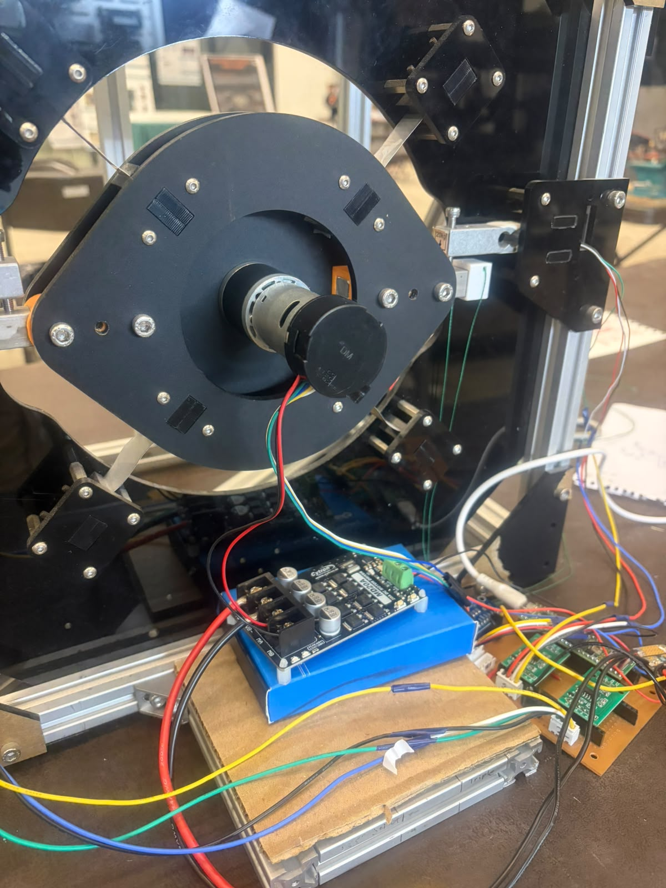{width=700}

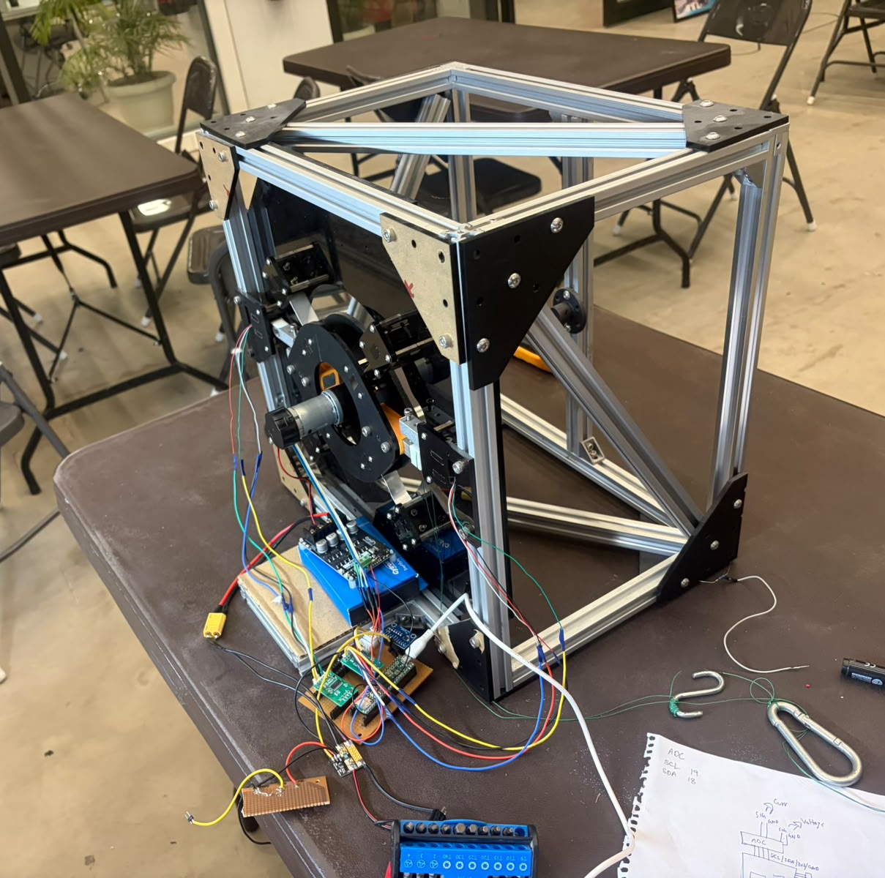{width=700}

**Next steps:**

- Complete the revised test rig.
- Integrate and calibrate the motor encoders.
- Calibrate load cells and current/voltage sensors.
- Validate synchronized data acquisition.
- Conduct step, ramp and sinusoidal PWM experiments.
- Characterize the three deadband effects.
- Develop and compare lookup-table, LSTM-based and physics-informed models.
- Evaluate the feedforward model alongside a feedback controller.

## Gallery

```{=html}
<div class="project-gallery-wrapper">
  <div class="project-gallery" id="motor-gallery"></div>
</div>
<div class="gallery-dots" id="motor-gallery-dots"></div>

<script>
(function () {
  const images = [
    "1000000212.jpeg",
    "1000000290.jpeg",
    "1000000293.jpeg",
    "1000001049.jpg",
    "1000001050.jpg",
    "1000001055.jpg",
    "1000001056.jpg"
  ];

  /* noscript fallbacks so Quarto's resource scanner sees the files */
  /* noscript:
    gallery_imgs/1000000212.jpeg
    gallery_imgs/1000000290.jpeg
    gallery_imgs/1000000293.jpeg
    gallery_imgs/1000001049.jpg
    gallery_imgs/1000001050.jpg
    gallery_imgs/1000001055.jpg
    gallery_imgs/1000001056.jpg
  */

  const PER_PAGE = 4; // 2x2
  const gallery  = document.getElementById('motor-gallery');
  const dotsEl   = document.getElementById('motor-gallery-dots');

  // Chunk images into pages of 4
  const pages = [];
  for (let i = 0; i < images.length; i += PER_PAGE) {
    pages.push(images.slice(i, i + PER_PAGE));
  }

  // Build pages
  pages.forEach((pageImgs, pi) => {
    const page = document.createElement('div');
    page.className = 'gallery-page';

    pageImgs.forEach(filename => {
      const img = document.createElement('img');
      img.src     = `gallery_imgs/${filename}`;
      img.alt     = filename;
      img.loading = 'lazy';
      img.title   = 'Click to open full resolution';
      img.onclick = () => window.open(img.src, '_blank');
      page.appendChild(img);
    });

    // If last page has < 4 images, fill blanks so grid stays even
    for (let j = pageImgs.length; j < PER_PAGE; j++) {
      const blank = document.createElement('div');
      blank.className = 'gallery-placeholder';
      page.appendChild(blank);
    }

    gallery.appendChild(page);
  });

  // Dot indicators
  const dots = pages.map((_, i) => {
    const d = document.createElement('button');
    d.className = 'dot' + (i === 0 ? ' active' : '');
    d.setAttribute('aria-label', `Go to page ${i + 1}`);
    d.onclick = () => gallery.scrollTo({ left: i * gallery.clientWidth, behavior: 'smooth' });
    dotsEl.appendChild(d);
    return d;
  });

  // Update active dot on scroll
  gallery.addEventListener('scroll', () => {
    const idx = Math.round(gallery.scrollLeft / gallery.clientWidth);
    dots.forEach((d, i) => d.classList.toggle('active', i === idx));
  });

  // Mouse-wheel → horizontal slide (one full page per scroll tick)
  gallery.addEventListener('wheel', e => {
    if (e.deltaY === 0 || e.shiftKey) return;
    const atStart = gallery.scrollLeft <= 0 && e.deltaY < 0;
    const atEnd   = gallery.scrollLeft + gallery.clientWidth >= gallery.scrollWidth - 1 && e.deltaY > 0;
    if (!atStart && !atEnd) {
      e.preventDefault();
      const currentPage = Math.round(gallery.scrollLeft / gallery.clientWidth);
      const targetPage  = currentPage + (e.deltaY > 0 ? 1 : -1);
      gallery.scrollTo({ left: targetPage * gallery.clientWidth, behavior: 'smooth' });
    }
  }, { passive: false });
})();
</script>
```