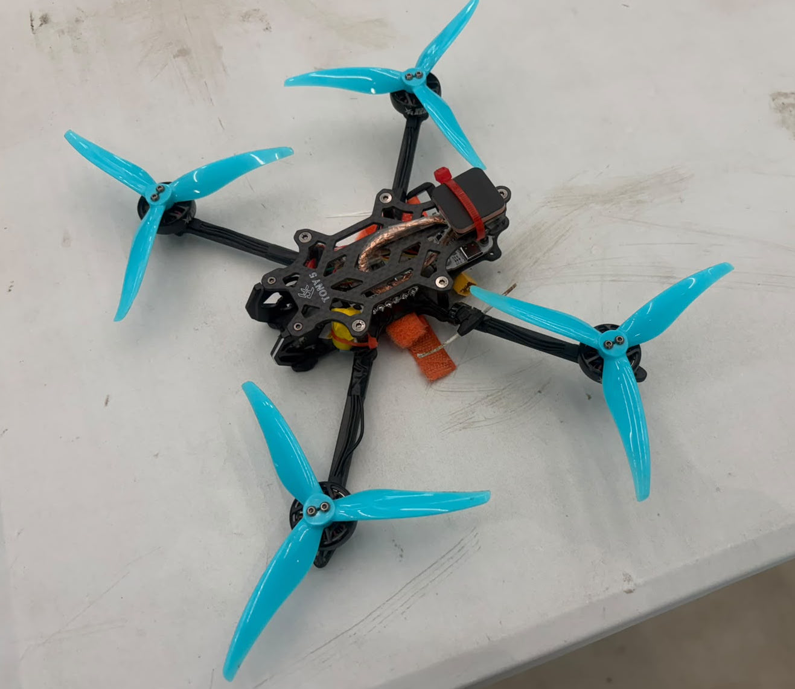
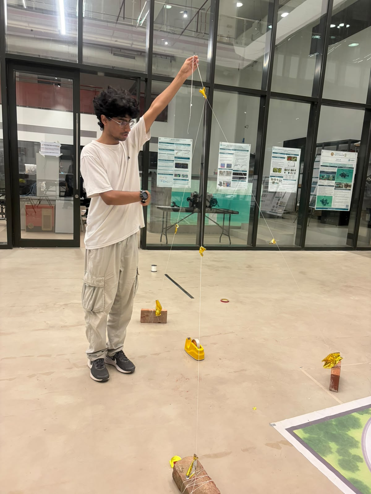
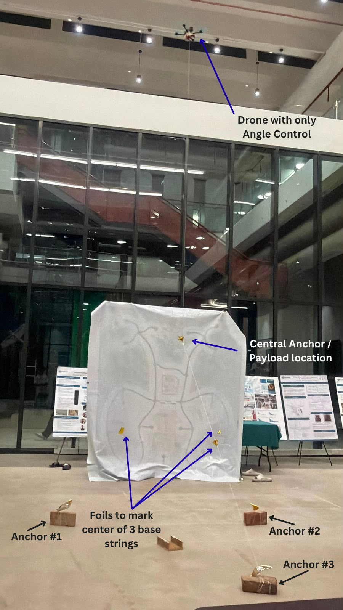
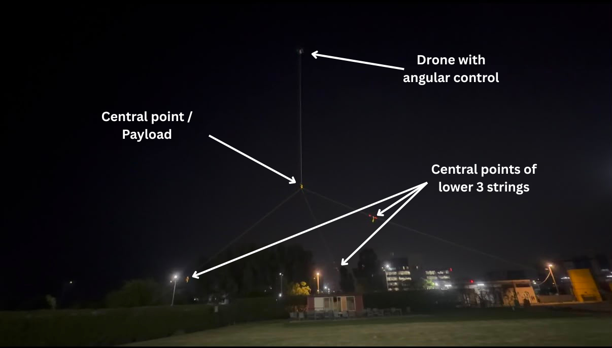

::: {.link-row}
[<i class="bi bi-file-earmark-pdf"></i> Report](/assets/files/tether.pdf)
:::

## Project Overview

The objective of this project was to investigate whether an elevated payload could be maintained at a spatially constrained position using a tensioned tether system, without requiring GPS-based positional control of the aerial platform.

A 5-inch LW quadrotor equipped with GPS and running INAV was used as the initial proof-of-concept. Three ground anchors were connected to a common central junction, with a fourth tether connecting the junction to the drone.

The drone was operated in Angle mode with sufficient throttle to maintain tension in the upper tether. Although the drone was allowed to move and loiter around the region above the junction, the central point remained spatially constrained. This demonstrated that GPS positional hold was not necessary; sufficient angular control to maintain tether tension was the primary requirement.

{width=65%}

## Experimental Setup

Three ground anchors, constructed using bricks and eyebolts, were arranged around a common central junction. The three lower strings converged at this point, while a fourth string connected it to the drone.

{width=65%}

The setup was subsequently tested outdoors at greater altitude. The drone was operated using only Angle mode, while the tether geometry constrained the central payload location.

{width=80%}

{width=85%}

## Future Development

The long-term objective is to replace the multirotor with a buoyant blimp-kite hybrid capable of maintaining an approximately 1 kg payload at an elevated position for extended periods.

The primary design considerations are energy efficiency and endurance. Buoyancy and aerodynamic lift will provide most of the required supporting force, while active control will primarily be used to maintain orientation and tether tension.

Future testing will investigate outdoor operation at greater altitudes, wind disturbances, power tethering, increased payload capacity, and long-duration endurance.

## Experimental Report

The complete experimental report, including the methodology, observations, findings, and future development objectives, is available below.

```{=html}
<div class="embed-frame embed-frame-doc">
<iframe src="/assets/files/tether.pdf" title="Tension-Based Spatial Localization - Experimental Report"></iframe>
</div>
```

