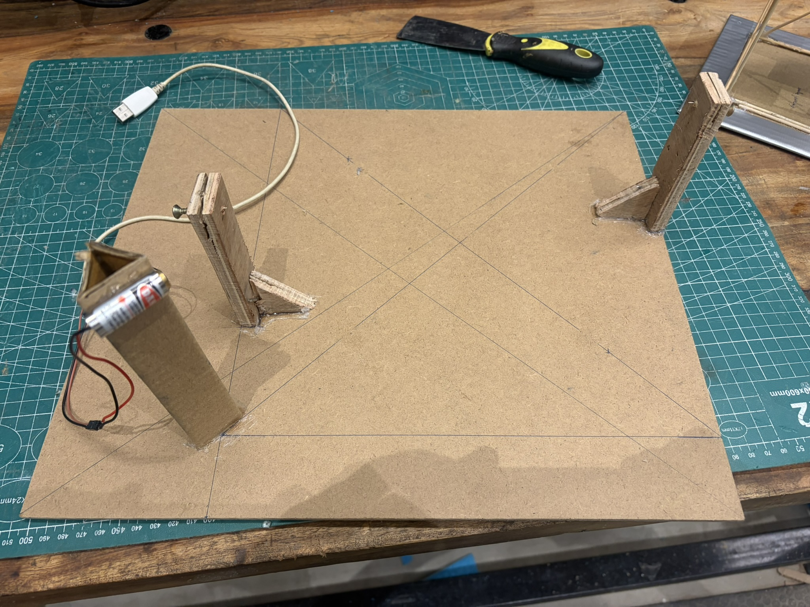
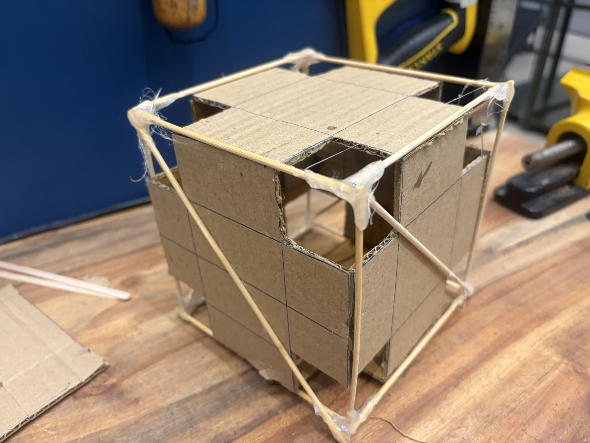
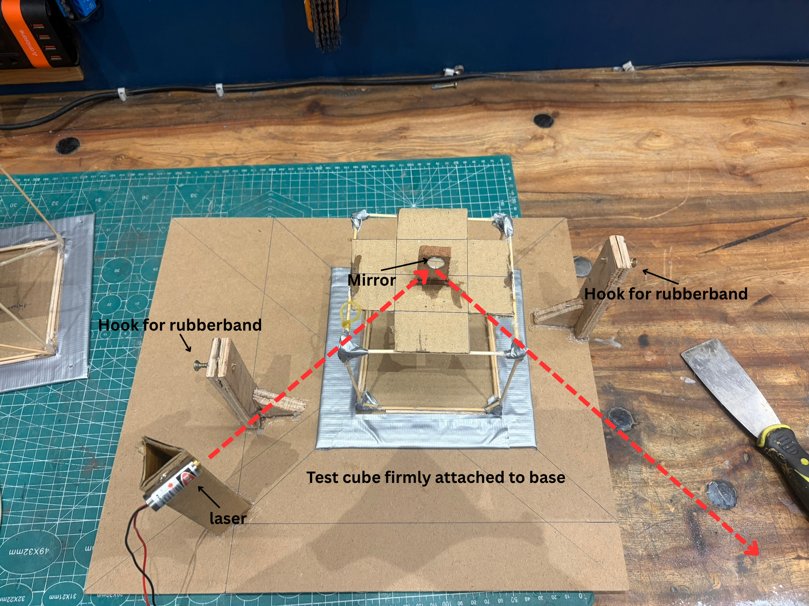
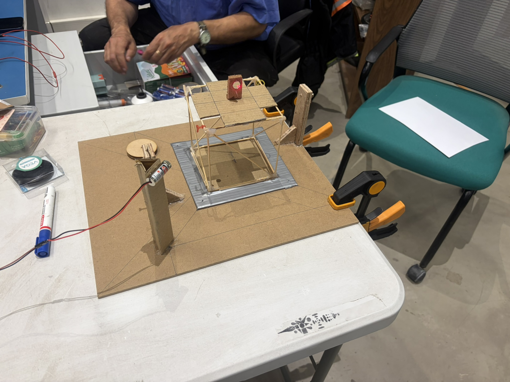
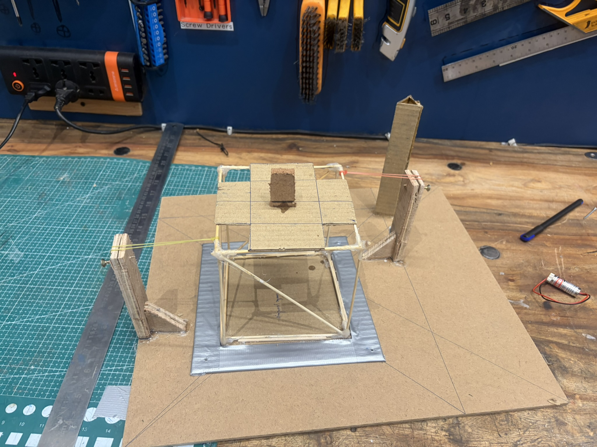
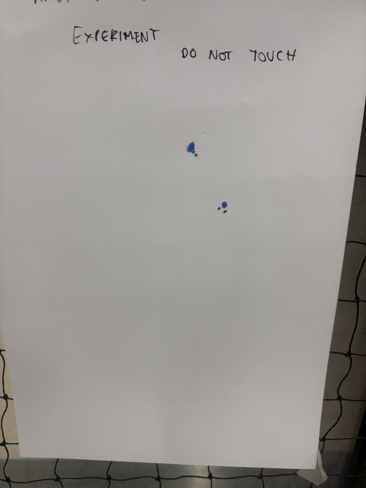
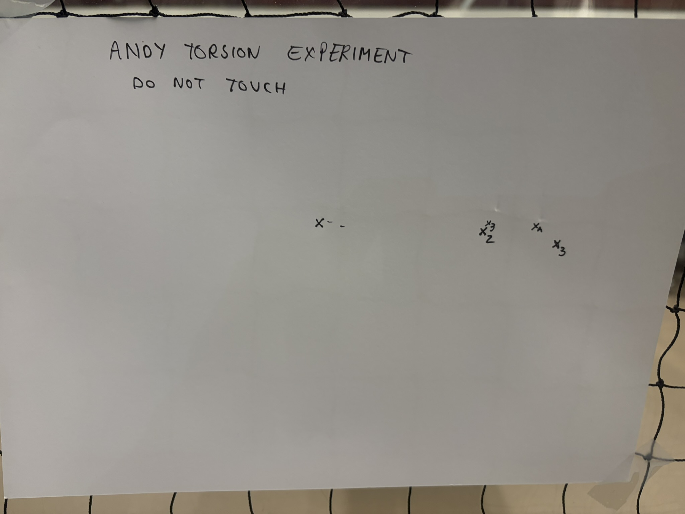

::: {.link-row}
[<i class="bi bi-file-earmark-pdf"></i> Report](/assets/files/torsion.pdf)
:::

## Project Overview

As part of the ILGC motor testing project, we conducted an experiment to investigate the torsional rigidity of a lightweight structural assembly. The experiment compared the response of the structure in trussed and untrussed configurations, using an applied torque and an optical measurement arrangement to observe the resulting angular deflection.

The test rig was assembled on a fixed base. Rubber bands were used to apply the twisting load, while a mirror-and-laser arrangement provided a way to observe small changes in the structure's orientation. Readings were recorded for the two configurations to compare their resistance to twisting.

The experiment provided a practical demonstration of how structural bracing influences torsional stiffness. The full report, including the experimental procedure, readings, calculations, and analysis, is attached below.

## Experimental Setup

The setup consisted of a base supporting the test structure, attachment points for the rubber-band loading arrangement, and a laser-and-mirror measurement system. The structure was tested in both trussed and untrussed configurations so that their responses could be compared under the experimental arrangement.

{width=650}

{width=650}

{width=650}

{width=650}

{width=650}

## Measurements

The laser-and-mirror arrangement was used to observe the change in the reflected laser position as the structure twisted. Separate readings were recorded for the trussed and untrussed configurations.

{width=650}

{width=650}

## Report

The complete experimental report, containing the detailed methodology, measurements, calculations, and discussion, is available below.

```{=html}
<div class="embed-frame embed-frame-doc">
<iframe src="/assets/files/torsion.pdf" title="Torsional Rigidity Experiment Report"></iframe>
</div>
```

