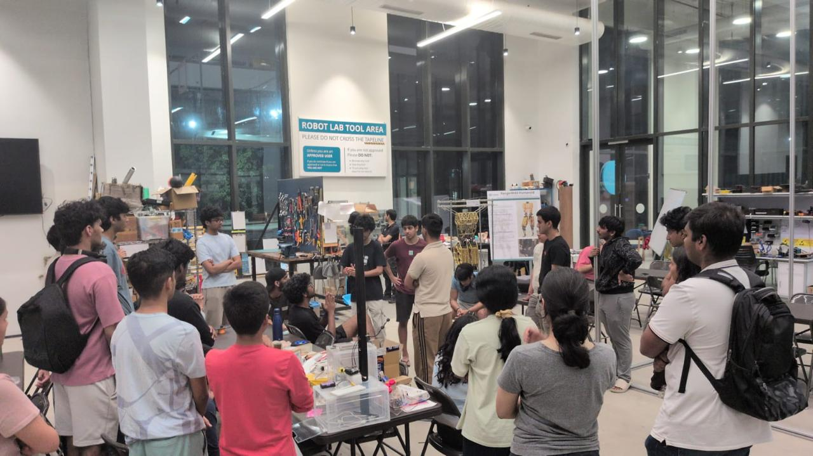
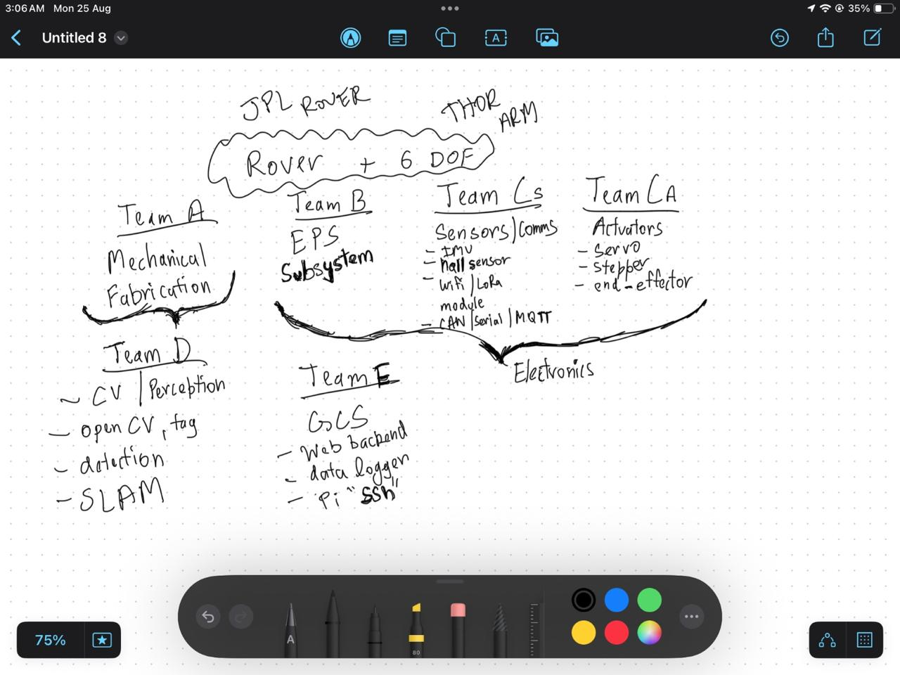
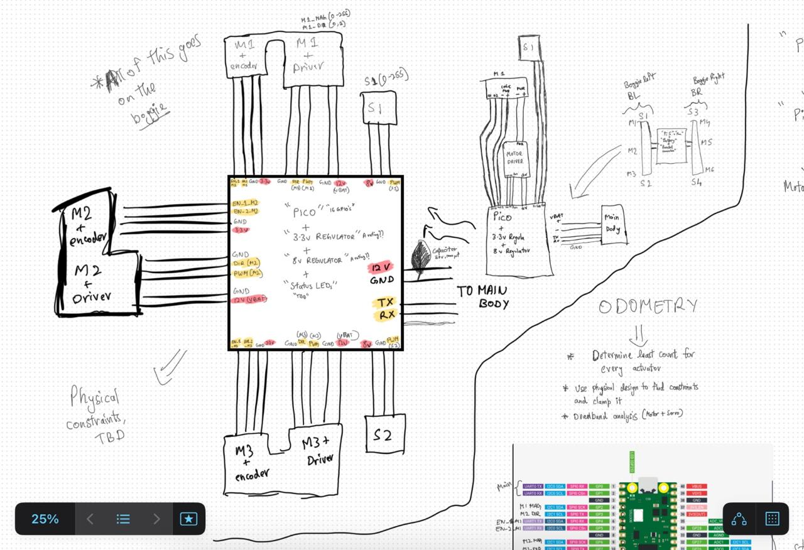
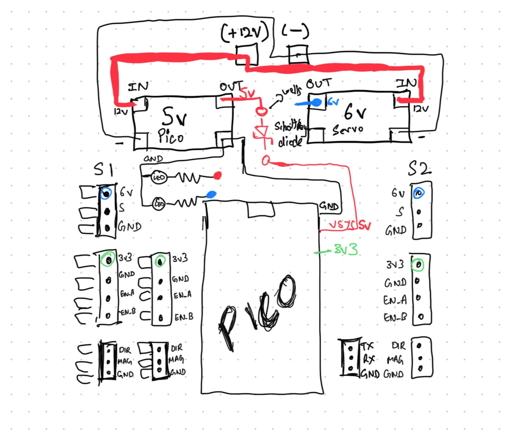
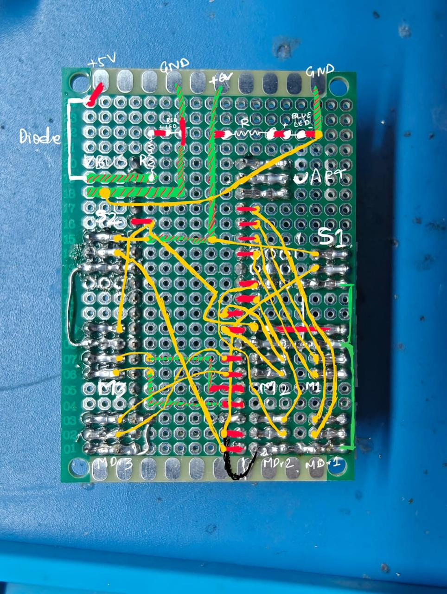
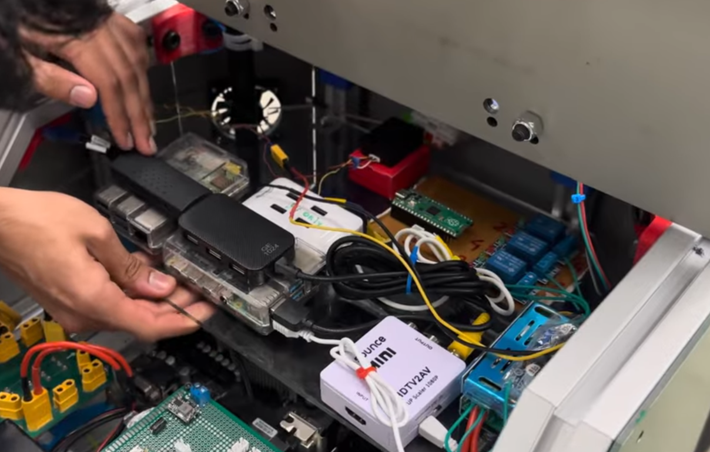
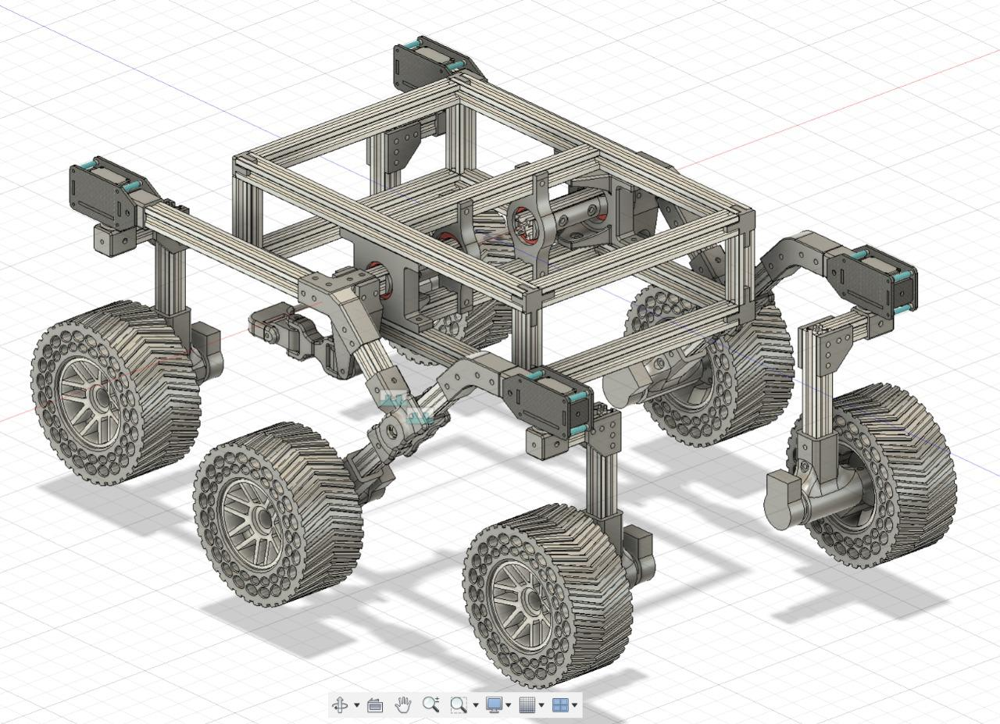
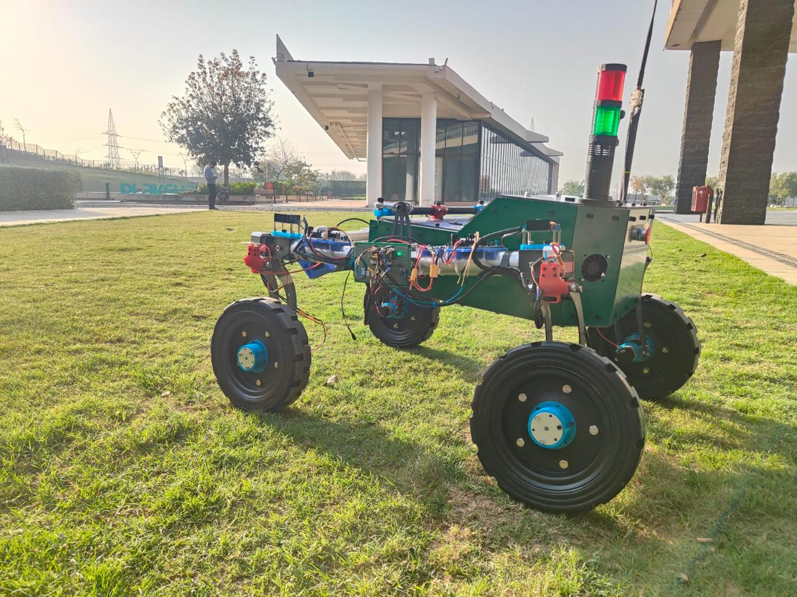

## Instructor: [Prof. Deepan Muthirayan](https://www.linkedin.com/in/deepan-raj-prabakar-muthirayan-a0143728/)

## Problem Statement

The [University Rover Challenge (URC)](https://urc.marssociety.org/) is an international robotics competition organized by The Mars Society. It challenges university teams to design, build, and operate a rover capable of assisting future astronauts on the surface of Mars. Widely regarded as one of the most demanding university-level rover competitions, URC tests not just whether a robot can move, but whether it can operate as a complete autonomous and remotely supervised field system.

The competition takes place in the Mars Desert Research Station (MDRS) in Utah, where teams must develop rovers capable of navigating rugged desert terrain and completing a series of mission-specific tasks. The challenge brings together mechanical engineering, electronics, embedded systems, computer vision, communications, control theory, and autonomous robotics.

The competition is divided into four primary missions:

- **Science Mission:** Investigate sites for their potential to support microbial life. The rover must identify areas of scientific interest, collect subsurface soil samples, perform onboard analysis using a biosciences payload, and securely store a sample for retrieval.
- **Delivery Mission:** Transport tools, samples, and other objects across challenging terrain to assist astronauts. The rover must locate, retrieve, and deliver objects while maintaining reliable communication with the ground station.
- **Equipment Servicing Mission:** Use a robotic manipulator to interact with a mock lander and perform dexterous operations. Tasks include handling objects, opening drawers and panels, operating switches and valves, connecting hoses, and manipulating other equipment.
- **Autonomous Navigation Mission:** Traverse the competition landscape without continuous human control. The rover must use positioning systems, onboard sensors, and computer vision to reach designated coordinates, identify objects, avoid obstacles, and navigate between waypoints.

The challenge is to develop a single integrated platform capable of performing all these tasks in an unpredictable outdoor environment. This requires a close coupling between the rover's mechanical design, electrical architecture, embedded control, sensing, communication, and autonomy stack.

## Building the Team

Following our experience at **CanSat 2025**, a few members of the original team decided to take on the much larger challenge of building a Mars rover for URC. We established the team under the [Kalki Robotics Club](https://www.linkedin.com/company/team-kalki/posts/) at Plaksha University and began recruiting students to develop the platform.

At the time, our university was relatively young and had very few senior students with prior robotics experience. We recruited a large number of first-year students, many of whom were completely new to robotics and mechatronics. Approximately **80% of the team consisted of juniors**, making training and technical onboarding a major part of the project.

As Team Lead / CTO, I was responsible for establishing the team's technical direction and creating the workflows needed to develop the rover. This involved breaking down the overall system into manageable subsystems, defining tasks, assigning responsibilities, setting development priorities, and coordinating progress across the team.

A significant part of my role was also teaching. I worked with newer members to introduce them to the fundamentals of mechatronics, electronics, CAD, 3D printing, fabrication, and system integration. The objective was not just to get the rover built, but to develop a team capable of independently designing, building, and testing its subsystems.

{width=700}

## My Role as CTO

My responsibilities extended across almost the entire rover architecture. I oversaw the **mechanical, electronics, and embedded systems workstreams**, while independently taking ownership of the communications subsystem.

Beyond subsystem development, I was involved in system-level decisions and the interfaces between different parts of the rover. This included planning the power architecture, defining communication interfaces, coordinating hardware requirements, and ensuring that mechanical and electrical designs could be integrated into a single platform.

My work broadly covered:

- **Mechanical:** Oversight of the rover chassis, mobility architecture, mechanical packaging, and fabrication.
- **Electronics:** Developing the electrical architecture, power distribution, voltage regulation, and signal interfaces.
- **Embedded Systems:** Coordinating firmware development and the interface between sensors, motor controllers, and the onboard computer.
- **Communications:** Designing the rover's RF communication architecture, including links for remote control, telemetry, and video.
- **Controls and Autonomy:** Contributing to the rover's control architecture, from low-level motor control to higher-level navigation and planning.
- **Team Development:** Establishing workflows, assigning tasks, mentoring new members, and coordinating subsystem integration.

{width=700}

## Controls and Autonomous Navigation

One of the more technically involved aspects of the project was developing the rover's control and autonomy architecture.

We worked closely with our mentors through frequent technical meetings, where we discussed the software architecture and the progression from low-level motor control to higher-level autonomous navigation.

### High-Level Navigation and Path Planning

We had access to a 3D map of the competition site and planned to use onboard LiDAR for environmental perception. This allowed us to investigate and simulate different approaches to autonomous navigation before deploying them on the physical rover.

Some of the algorithms and approaches we explored included:

- **A\* and Dijkstra's algorithms:** Grid-based path planning for finding routes between waypoints.
- **Model Predictive Control (MPC):** Investigating trajectory tracking and control while accounting for the rover's motion constraints.
- **Pure Pursuit:** Evaluating a geometric path-tracking approach for following planned trajectories.

The broader objective was to create a navigation stack that could use environmental information to plan routes and translate those routes into executable motion commands.

### Low-Level Mobility Control

At the lower levels, we focused on controlling the rover's velocity and heading while accounting for the limitations of its drivetrain and the terrain.

This included:

- **Encoder-based dead reckoning:** Using motor encoders to estimate wheel rotation and rover displacement.
- **Velocity and heading control:** Controlling the rover's movement and orientation.
- **Wheel slip detection:** Investigating motor torque monitoring as a way to identify wheel slippage, particularly when traversing loose sand.

These layers had to work together: the navigation system would determine where the rover needed to go, while the lower-level controllers would handle how it moved.

## Electronics Architecture

I was responsible for developing the rover's electronics architecture and defining how the different electrical subsystems would be powered and communicate.

The system needed to support high-current mobility actuators, embedded controllers, sensors, onboard computing, and long-range communication hardware. This required careful consideration of power distribution, voltage regulation, signal interfaces, and the separation of different electrical domains.

The architecture was designed around a distributed system of onboard electronics, with different nodes communicating over dedicated interfaces.

Key areas of work included:

- Power distribution and voltage regulation for the different subsystems.
- Defining the signaling and communication interfaces between onboard devices.
- Integrating sensors, motor controllers, embedded boards, and communication hardware.
- Planning the electrical architecture around the rover's overall power and operational requirements.

{width=700}

{width=700}

{width=700}


## RF Communications Architecture

I independently designed and integrated the rover's RF communications subsystem. The architecture used separate radio links for command and telemetry transmission, and analog video transmission.

### 900 MHz — Control and Telemetry

We used the **900 MHz band** for the rover's control and telemetry links.

The two links used different antenna configurations:

- **Telemetry:** A 5 dBi dipole antenna on the rover communicating with a dipole antenna at the ground station.
- **Control:** A 2 dBi dipole antenna on the rover communicating with a 3.2 dBi Moxon antenna at the ground station.

Separating the control and telemetry links allowed us to plan their antenna configurations around their respective communication requirements.

### 5.8 GHz — Analog Video Transmission

For the live video feed, we implemented a separate **5.8 GHz analog video transmission system**.

The rover carried **nine onboard cameras**, connected to a Raspberry Pi. The Pi's display output was routed through an HDMI-to-AV converter and fed into a **5 W, 5.8 GHz video transmitter (VTX)**.

The video transmission setup used:

- **Onboard:** 5 W 5.8 GHz analog VTX with dual 3 dBi cloverleaf antennas.
- **Ground station:** A diversity antenna setup combining dual 3 dBi cloverleaf antennas and a 9 dBi crosshair patch antenna.

The diversity setup provided multiple antenna reception paths for the incoming video signal.

### Communications Integration

The communications subsystem brought together the rover's command, telemetry, and video links into a single onboard architecture. This required coordinating radio hardware, antenna placement, power requirements, signal interfaces, and the ground-station equipment.

**Rover Communications Plate**

{width=700}

## Mechanical Design and Fabrication

The mechanical subsystem was a significant step up in scale from the projects I had worked on previously.

Unlike smaller prototypes and student projects, the rover required a large structural frame capable of supporting its drivetrain, electronics, manipulator, and mission-specific payloads. I worked with **aluminium tubing and extrusions**, learning to design and assemble structures at a much larger scale.

This introduced new considerations around structural rigidity, mounting interfaces, component packaging, serviceability, and fabrication constraints.

The mechanical design also had to accommodate several interconnected subsystems. The chassis could not be designed in isolation: the placement of motors, batteries, electronics, sensors, and the manipulator all influenced the overall layout.

{width=700}

## Rover Development

We developed two rover platforms during the project, each representing a different stage in our understanding of the system and its requirements.

### Rover V1 — Six-Wheel Prototype - JPL rover

Our first prototype was a six-wheel rover inspired by JPL's open-source rover designs.

Rather than developing every aspect of the platform from scratch, we used the reference architecture to understand the mechanical layout and mobility system. The design was reverse-engineered and adapted into a functional RC-controlled rover.

Rover V1 served as an initial platform for understanding the mechanical and electrical requirements of a larger mobile robot. It helped us gain practical experience with chassis construction, drivetrain integration, wiring, and remote operation before moving towards a more ambitious design.

**Rover V1 — Prototype Demonstration**

::: {#fig-fp_video}

<video src="offroad_v2.mp4" width="600" autoplay loop muted playsinline></video>

Rover V1 offroading.
:::

::: {#fig-fp_video}

<video src="climb.mp4" width="600" autoplay loop muted playsinline></video>

Rover V1 climbing.
:::

### Rover V2 — Trevora

Trevora was our second-generation rover, developed with a substantially more ambitious design.

Unlike V1, which was adapted from an existing reference architecture, Trevora was designed and built from the ground up. It moved to a four-wheel configuration and was approximately twice the size of the first prototype.

The redesign gave us an opportunity to revisit the chassis architecture, mechanical packaging, subsystem placement, and overall system integration.

Trevora represented a shift from building an initial proof-of-concept rover to developing a much larger and more integrated competition platform.

**Rover V2 — Trevora Demonstration**

{width=700}

## Competition Progress

The team successfully cleared the **Preliminary Design Review (PDR) for the 2026 season**.

This milestone involved presenting the proposed rover architecture, subsystem designs, and engineering approach for evaluation. It was an important step for a relatively young team that had started with a large proportion of members who were new to robotics.

The project brought together students from different academic backgrounds and gave them the opportunity to work on a complex engineering system, from initial design and simulation to fabrication and prototype integration.

## What I Learned

URC was my first experience leading the development of a large, multidisciplinary robotic system.

The project pushed me beyond individual component design and required me to think about the rover as an integrated platform. A decision in the mechanical subsystem could affect electronics packaging; a change in the power architecture could influence actuator selection; and the performance of the mobility system could directly affect the autonomy stack.

Equally important was learning how to build and lead a technical team. With most members being new to robotics, I had to balance engineering decisions with mentoring, planning, delegation, and technical training.

## Gallery

```{=html}
<div class="project-gallery-wrapper">
  <div class="project-gallery" id="urc-gallery"></div>
</div>
<div class="gallery-dots" id="urc-gallery-dots"></div>

<script>
(function () {
  const images = [
    "rover_in_1.jpeg",
    "comms_1.png",
    "rover_2.jpeg",
    "rover_v2.jpeg",
    "team.jpeg",
    "jpl fusion.jpeg",
    "comms_3.png",
    "presentation.jpeg",
    "pcb_schem.jpeg",
    "rover_3.jpeg",
    "notes_3.jpeg",
    "sensors.jpeg",
    "team_3.jpeg",
    "notes_4.jpeg",
    "rover_ready.jpeg",
    "rover_4.jpeg",
    "team_1.jpg",
    "board_1.jpeg",
    "rover_1.jpeg",
    "rover_back.jpeg",
    "board_2.jpeg",
    "rover_5.jpeg",
    "rover_inside.jpeg",
    "team_2.jpg",
    "comms_2.png",
    "rover_v2_2.jpeg",
    "notes_1.jpeg",
    "notes_2.jpeg",
    "rover_side.jpeg",
    "WhatsApp Image 2026-11-05 at 12.34.32 AM (1).jpeg",
    "rover_in_2.jpeg"
  ];

  /* noscript fallbacks so Quarto's resource scanner sees the files */
  /* noscript:
    gallery_imgs/rover_in_1.jpeg
    gallery_imgs/rover_2.jpeg
    gallery_imgs/notes_4.jpeg
    gallery_imgs/rover_v2.jpeg
    gallery_imgs/team.jpeg
    gallery_imgs/jpl fusion.jpeg
    gallery_imgs/comms_3.png
    gallery_imgs/presentation.jpeg
    gallery_imgs/pcb_schem.jpeg
    gallery_imgs/rover_3.jpeg
    gallery_imgs/notes_3.jpeg
    gallery_imgs/sensors.jpeg
    gallery_imgs/team_3.jpeg
    gallery_imgs/rover_ready.jpeg
    gallery_imgs/rover_4.jpeg
    gallery_imgs/team_1.jpg
    gallery_imgs/board_1.jpeg
    gallery_imgs/rover_1.jpeg
    gallery_imgs/rover_back.jpeg
    gallery_imgs/board_2.jpeg
    gallery_imgs/rover_5.jpeg
    gallery_imgs/rover_inside.jpeg
    gallery_imgs/team_2.jpg
    gallery_imgs/comms_2.png
    gallery_imgs/rover_v2_2.jpeg
    gallery_imgs/notes_1.jpeg
    gallery_imgs/notes_2.jpeg
    gallery_imgs/rover_side.jpeg
    gallery_imgs/WhatsApp Image 2026-11-05 at 12.34.32 AM (1).jpeg
    gallery_imgs/comms_1.png
    gallery_imgs/rover_in_2.jpeg
  */

  // Shuffle images randomly
  for (let i = images.length - 1; i > 0; i--) {
    const j = Math.floor(Math.random() * (i + 1));
    [images[i], images[j]] = [images[j], images[i]];
  }

  const PER_PAGE = 4; // 2x2
  const gallery  = document.getElementById('urc-gallery');
  const dotsEl   = document.getElementById('urc-gallery-dots');

  // Chunk images into pages of 4
  const pages = [];
  for (let i = 0; i < images.length; i += PER_PAGE) {
    pages.push(images.slice(i, i + PER_PAGE));
  }

  // Build pages
  pages.forEach((pageImgs, pi) => {
    const page = document.createElement('div');
    page.className = 'gallery-page';

    pageImgs.forEach(filename => {
      const img = document.createElement('img');
      img.src     = `gallery_imgs/${filename}`;
      img.alt     = filename;
      img.loading = 'lazy';
      img.title   = 'Click to open full resolution';
      img.onclick = () => window.open(img.src, '_blank');
      page.appendChild(img);
    });

    // If last page has < 4 images, fill blanks so grid stays even
    for (let j = pageImgs.length; j < PER_PAGE; j++) {
      const blank = document.createElement('div');
      blank.className = 'gallery-placeholder';
      page.appendChild(blank);
    }

    gallery.appendChild(page);
  });

  // Dot indicators
  const dots = pages.map((_, i) => {
    const d = document.createElement('button');
    d.className = 'dot' + (i === 0 ? ' active' : '');
    d.setAttribute('aria-label', `Go to page ${i + 1}`);
    d.onclick = () => gallery.scrollTo({ left: i * gallery.clientWidth, behavior: 'smooth' });
    dotsEl.appendChild(d);
    return d;
  });

  // Update active dot on scroll
  gallery.addEventListener('scroll', () => {
    const idx = Math.round(gallery.scrollLeft / gallery.clientWidth);
    dots.forEach((d, i) => d.classList.toggle('active', i === idx));
  });

  // Mouse-wheel → horizontal slide (one full page per scroll tick)
  gallery.addEventListener('wheel', e => {
    if (e.deltaY === 0 || e.shiftKey) return;
    const atStart = gallery.scrollLeft <= 0 && e.deltaY < 0;
    const atEnd   = gallery.scrollLeft + gallery.clientWidth >= gallery.scrollWidth - 1 && e.deltaY > 0;
    if (!atStart && !atEnd) {
      e.preventDefault();
      const currentPage = Math.round(gallery.scrollLeft / gallery.clientWidth);
      const targetPage  = currentPage + (e.deltaY > 0 ? 1 : -1);
      gallery.scrollTo({ left: targetPage * gallery.clientWidth, behavior: 'smooth' });
    }
  }, { passive: false });
})();
</script>
```
